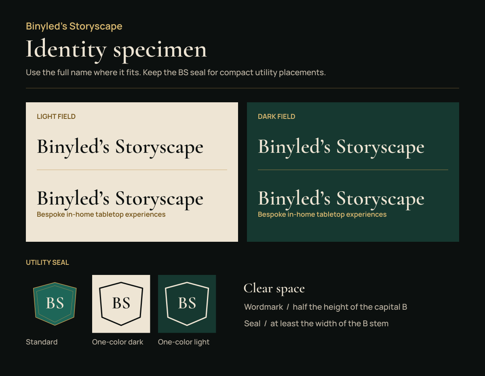
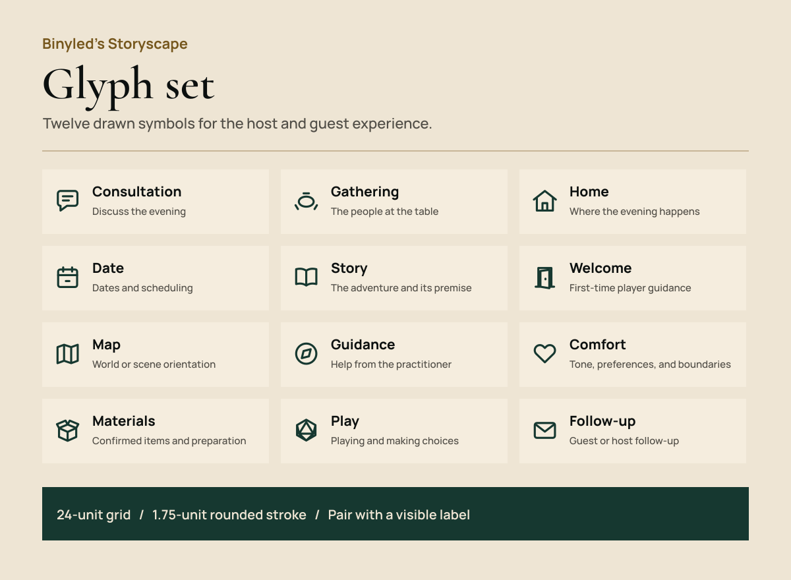

# Identity and glyph usage

**Binyled’s Storyscape · Production guide · November 12, 2026**

The full name is the primary public identifier. Use the possessive apostrophe and the capital S in Storyscape. Use **The Private Storyscape** for the flagship experience. The **BS** utility seal is reserved for compact placements such as a favicon or avatar where surrounding context identifies the account.

[Identity specimen SVG](assets/identity/identity-specimen.svg) · [Identity specimen PNG](assets/identity/identity-specimen.png)

## Choose an identity asset

Filenames describe the ink. Place **dark** files on light backgrounds and **light** files on dark backgrounds.

| Asset | Placement | SVG masters | PNG exports |
| --- | --- | --- | --- |
| Name wordmark | Proposal covers, correspondence, event materials, or a composition with a separate service descriptor | [Dark ink](assets/identity/wordmark-dark.svg) · [Light ink](assets/identity/wordmark-light.svg) | [Dark ink](assets/identity/wordmark-dark.png) · [Light ink](assets/identity/wordmark-light.png) |
| Descriptor lockup | First-contact or referral materials where the audience needs the category immediately | [Dark ink](assets/identity/lockup-dark.svg) · [Light ink](assets/identity/lockup-light.svg) | [Dark ink](assets/identity/lockup-dark.png) · [Light ink](assets/identity/lockup-light.png) |
| Standard BS utility seal | Compact avatar or utility placement with a known account name or an adjacent full name | [Standard seal](assets/identity/utility-seal.svg) | [Standard seal](assets/identity/utility-seal.png) |
| One-color BS utility seal | Single-ink utility use or a transparent mark over an approved solid field | [Dark ink](assets/identity/utility-seal-1c-dark.svg) · [Light ink](assets/identity/utility-seal-1c-light.svg) | [Dark ink](assets/identity/utility-seal-1c-dark.png) · [Light ink](assets/identity/utility-seal-1c-light.png) |

- **Wordmark.** Allow at least half the capital B height between the visible artwork and neighboring content or trim. Start at **230 CSS px** or **60 mm** across for the complete asset.
- **Descriptor lockup.** Measure clear space from the outside of both lines. Start at **350 CSS px** or **90 mm** across. At smaller sizes, set the name and descriptor as separately reflowable live text.
- **Utility seal.** Allow at least one B stem width from the visible outline to surrounding artwork. Use **48 CSS px** or **12 mm** across as the preferred minimum. The standard digital seal can go down to **32 CSS px** in compact utility contexts. Use the existing generated favicon family for browser and home-screen favicon slots.
- **Proportions and contrast.** Use a solid Obsidian, Deep Forest, or Parchment field. Keep the asset's original aspect ratio and use the matching ink version. Preserve the typography, spacing, and silhouette. Avoid shadows, outlines around the lettering, and placing the marks directly over detailed photography.
- **Accessible name.** For a standalone wordmark image, use `alt="Binyled’s Storyscape"`. Include the descriptor in the alt text only if it carries information absent from nearby copy. Inside a home link, give the link a name such as “Binyled’s Storyscape home.” Give a redundant utility mark empty alt text.

The SVGs contain outlined Cormorant Garamond and Manrope from the repository fonts, so they open without a font installation. PNG exports provide fallbacks for upload forms, email, and office tools. Name and descriptor PNGs are 860 px wide. Seal PNGs are 512 px square. Treat RGB colors as sRGB references and proof the chosen stock and process with the printer. The web and print widths here are recommendations for this artwork and should be checked in the actual placement.

The vector utility seal follows the silhouette and colors of the existing favicon source and uses the site's Cormorant Garamond treatment for BS. The one-color variant has a heavier outer rule for reproduction. The separately referenced dragon-and-shield crest remains an owner-supplied asset. The Storyscape header selects the wordmark ink by theme and switches to the name in text at widths of 430 CSS px and below. The dark footer uses the light ink version. The Wayfarer Table profile uses its own WT mark and name. [Asset register](ASSET_REGISTER.md) · [Brand mark template](../layouts/_partials/brand-mark.html) · [Responsive treatment](../assets/scss/_storyscape.scss)

## Glyph set

[Contact sheet SVG](assets/glyphs/glyph-sheet.svg) · [Contact sheet PNG](assets/glyphs/glyph-sheet.png) · [Web sprite SVG](assets/glyphs/glyph-sprite.svg)

| Glyph | Recommended usage | Example visible label |
| --- | --- | --- |
| [Consultation](assets/glyphs/consultation.svg) | Consultation invitation or process step | Request a private consultation |
| [Gathering](assets/glyphs/gathering.svg) | Guest count, table composition, or an introduction to the group | Your guests |
| [Home](assets/glyphs/home.svg) | In-home setting, location discussion, or host logistics | Where we’ll play |
| [Date](assets/glyphs/date.svg) | Availability, preferred dates, or an agreed schedule | Your preferred date |
| [Story](assets/glyphs/story.svg) | Premise, example adventure, or story direction | The adventure |
| [Welcome](assets/glyphs/welcome.svg) | First-session orientation or onboarding | New to tabletop play? |
| [Map](assets/glyphs/map.svg) | Fictional world or scene orientation | Explore the setting |
| [Guidance](assets/glyphs/guidance.svg) | Rules guidance, pacing, or practical help | I’ll guide the table |
| [Comfort](assets/glyphs/comfort.svg) | Guest preferences, boundaries, or table comfort | What feels right for your guests |
| [Materials](assets/glyphs/materials.svg) | Preparation or items confirmed for a specific evening | Materials we’ve agreed on |
| [Play](assets/glyphs/play.svg) | Player choices or the play stage | Play the story |
| [Follow-up](assets/glyphs/follow-up.svg) | Post-session host or guest message | After the evening |

### Use glyphs consistently

Use the 24 × 24 design grid and its 1.75-unit rounded stroke. Set glyphs at **24 CSS px** by default, **20 px** for secondary labeled use, and **32 px** when they lead a section. For handouts, start at **6 mm**. Leave **8–12 px** between an icon and its label. Within a set, align the boxes and keep the ink color and scale consistent. Use the die selectively when its presence helps explain play.

Give each meaningful item a visible label. Redundant icons beside that label can be hidden from assistive technology. When a glyph supplies meaning to an image or action, give the image or control an accessible name that describes its purpose. A glyph's dimensions describe the artwork. Aim for a **44 × 44 CSS px** interactive target where practical, including the padding around the glyph and label. Use the interface's familiar controls for navigation, form state, validation, and closing dialogs. [WCAG 2.2 target size guidance](https://www.w3.org/WAI/WCAG22/Understanding/target-size-minimum.html)

Use Parchment on Obsidian (**15.31:1**) or Deep Forest (**10.22:1**), and Obsidian or Deep Forest on Parchment. Parchment on Verdigris is **5.42:1**. Antique Gold is suitable on Obsidian (**7.31:1**) and Deep Forest (**4.88:1**). Reserve Gold on Parchment (**2.10:1**) or Verdigris (**2.59:1**) and Mint on Parchment (**1.48:1**) for purely decorative treatment. Aim above **3:1** for meaningful graphics, and use at least **4.5:1** for ordinary text. Check the actual background under the graphic and the control's focused and selected states. [WCAG 2.2 non-text contrast](https://www.w3.org/WAI/WCAG22/Understanding/non-text-contrast.html) · [WCAG 2.2 text contrast](https://www.w3.org/WAI/WCAG22/Understanding/contrast-minimum.html)

### Implementation

Use an individual SVG as an image in documents or on the web. A standalone file uses the renderer's default `currentColor`, typically black. For theme-aware color, use the sprite or inline the geometry so it can inherit the foreground color. Each symbol ID is `storyscape-` followed by its filename stem. The sprite supplies the drawing. The containing label supplies the meaning.

The Storyscape process template uses the static sprite with `relURL` so the link also resolves when the site is built under a subpath. Each icon sits beside a visible step title. It uses `aria-hidden="true"` and `focusable="false"`. Change the `glyph` field for a process step in `data/home.yaml`. The template checks that the symbol exists. Profiles with Storyscape artwork turned off use step numbers. [Process template](../layouts/_partials/sections/process.html) · [Storyscape data](../data/home.yaml) · [Static sprite](../static/images/storyscape/glyph-sprite.svg)
