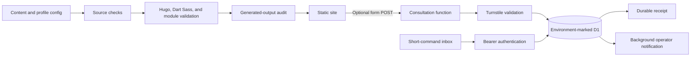

# Architecture and contracts

The project combines a static Hugo site, optional inquiry capture, and local
operator and session tools. The diagram follows the Cloudflare inquiry path.

## Content ownership

`hugo.yaml` holds the default Storyscape identity and navigation. Page Markdown
owns long-form copy and section composition. The build profile chooses what
content and identity Hugo reads.

| Profile | Content and identity | Build |
| --- | --- | --- |
| `exemplar` | Storyscape pages, artwork, and the readable, noindex brand guide | `npm run build` defaults to a local staging build |
| `client` | Same Storyscape pages and artwork, with the brand guide excluded | `SITE_PROFILE=client npm run build` or the Cloudflare build wrapper |
| `remote` | Fictional Wayfarer Table identity, `examples/remote/content/`, and `data/remote.json` | `INTAKE_BACKEND=disabled npm run build:remote` |

`scripts/build-site.mjs` supports disabled and Netlify intake. The remote
example's privacy notice describes a disabled form, so keep it in disabled
mode. The wrapper currently permits the Netlify setting for that profile.
`scripts/build-cloudflare.mjs` uses the client profile and requires an explicit
`INTAKE_ENV`. Both wrappers check source, generate a clean output directory, and
audit the result. Staging output is noindex and omits the sitemap. Noindex is an
indexing directive, and the exemplar guide remains accessible by URL.

`data/modules.yaml` is the module registry. Every template has a contract in
`data/module_schema.json`. The recursive Hugo validator checks required fields,
nonblank strings, collection items, links, image existence, and unknown keys.
Package rows must match the number of columns. The renderer reads module content
from `params.moduleData` (default `home`) and applies a selected variant from the
shared `data/variants.yaml` as a complete replacement. Composition owns order,
enabled state, module, ID, and variant. Trust and booking remain workshop-only.

The remote profile demonstrates reuse of the layouts. The shared CTA still
contains Storyscape wording, and profiles share theme styles and the static
asset manifest. A new identity needs a copy, styling, and rights review. See the
[sculpting guide](sculpting-guide.md) and [reuse policy](../REUSE.md).

## Artwork and release output

Storyscape's artwork switch enables the SVG wordmark, hero scene figures, and
process glyphs. `data/storyscape_artwork.yaml` owns the hero image paths and alt
text. The gallery reads its own item records from `data/home.yaml`. Brand source
assets and collateral are stored under `brand/` and selected web exports under
`static/images/storyscape/`. See the [image plan](image-plan.md).

`data/release.json` supplies required output routes and static files for all
profiles. Hugo's static mount excludes both `static/temp/` and
`static/images/temp/`, along with Finder metadata. The audit checks required
outputs, links, metadata, form controls, and the internal guide and workshop
rules. Its unexpected-file check currently exempts HTML and files under
`assets/`. Keep private files out of Hugo input directories and review the
generated file list before publishing.

## Inquiry flow

1. Reject unsupported methods, origins, hostnames, or missing runtime configuration.
2. Require the immutable D1 marker to match `INTAKE_ENV`.
3. Read a bounded body, reject unknown/repeated/file fields, enforce shared limits
   and choices from `data/intake.json`, and verify inquiry consent.
4. Validate a fresh Turnstile token with the expected hostname and action.
5. Insert the UUID and canonical payload hash. Sending the same UUID and payload
   returns the same receipt. Changed details return `request_conflict`.
6. Return a receipt only after storage acknowledgment. Notification runs separately.

Turnstile tokens expire and are single-use. A retry obtains a fresh token while
retaining the inquiry identity. The browser requires a valid matching receipt ID
before navigating. An unconfirmed response preserves the form and retry identity.
Recognized intake errors include stable codes, and field errors identify the
field. A privacy-version conflict requests review of the current notice. A
request conflict offers reconciliation or an explicit separate inquiry.

Only a UUID and fingerprint are remembered automatically in session storage.
Downloaded drafts contain personal data and are restored only after a
confirmation. A draft with an older consent version stays readable as a file.
The recovery message directs the visitor to contact the operator to reconcile
an uncertain earlier send.
Downloading a draft leaves the status of a prior submission unresolved.

## Operator and notification flow

The inbox accepts POST JSON and requires a bearer secret on every action.
Summaries exclude email and private notes, which are available through the
authenticated read action. Status changes carry a revision to reject stale
actions. Inquiry status and notification status are tracked separately.

The local CLI caches only ID/revision selectors for 15 minutes in ignored `.local/`
files, using private file permissions. Its list numbers minimize typing. Read
output appears in the terminal and should be treated as private. Retry
attempts delivery when a notification can be claimed. Mark contacted after
the human contact has happened.

Notifications claim a 60-second lease, omit vision/access notes, use REST
`reply_to`, and distinguish queued/delivered acceptance from mailbox placement.
A provider acceptance followed by a failed database acknowledgment may cause a
duplicate on recovery.

`npm run session` copies the synthetic Lantern Bay pack to a new ignored
`.local/sessions/` directory and records source file hashes. Copying the pack
starts an editable workspace with the sample data. The operator transfers any
appropriate inquiry details deliberately.

## Verification boundaries

Node tests exercise real in-memory SQLite through a D1-shaped adapter and mocked
provider responses. The client script tests use simulated DOMs. Hugo/HTML checks
validate generated structure. Browser and accessibility acceptance, provider
delivery, and a production backup restore require separate evidence. See the
[readiness ledger](readiness.md).

## Changing a field policy

`data/intake.json` owns text lengths, required text fields, enumerated choices,
and the positive guest-count floor. Hugo renders these rules and the backend
imports the same data. The output audit checks generated constraints against it.
Dates accept any real calendar date on both sides, including a past date for
a rescheduling request. The technical floor is one guest after migration 0003.
The operator confirms a practical group size in consultation. SQLite's structural
constraints are versioned migrations, so changing the structural floor also
requires a deliberate schema migration and a preservation regression.

## Change-to-check map

| Change | Owner-run targeted command |
| --- | --- |
| Declared asset files, template and schema presence, hosted tool pins | `npm run check:source` |
| Composition or module contract | `python3 scripts/check_modules.py` |
| HTML audit behavior | `python3 scripts/check_audit.py` |
| One site profile's content and generated output | `npm run build` with the intended profile |
| Intake, notification, operator authorization, browser state | `npm run test:intake` |
| Hosting mode output, including the remote example | `npm run test:hosting` |
| Combined release check | `npm run test:all` |

To author a module, use the `cards` template and its schema as a reference. Add
a registry entry, complete content, a schema if the data shape differs, and a
composition entry with a unique ID. Add a missing or invalid content fixture
alongside the valid case. The workshop reads the registry automatically. Keep
scaffolds restricted to the showcase until their real content or connected
capability is approved.
