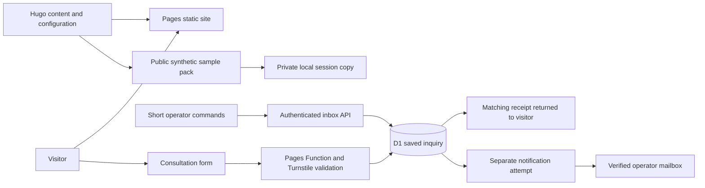

# How to get everything useful from Cloudflare for free or on the cheap

**For Binyleds / Storyscape. Cloudflare plans and limits were researched on
October 5, 2026.** Use [site operations](site-operations.md) for current
repository procedures and [readiness](readiness.md) for verification status.
For the proposed Storyscape launch, follow the
[Zoho mailbox and Cloudflare handoff plan](site-operations.md#november-21-handoff-plan).
The Gmail and inbound Email Routing examples below are alternatives.

The practical starting point is Hugo on Cloudflare Pages, Pages Functions only
for the three API routes, D1 for inquiries, Turnstile for the form, and a verified
operator mailbox for notifications. That arrangement can fit within free
allowances. Keep the existing mailbox and local preparation files. Add services
only when they remove an actual obstacle or recurring work.

The first paid option worth evaluating is **Workers Paid, starting at $5/month
per account**. It can provide additional runtime capacity and access to outbound
email to arbitrary recipients. It is separate from the website's Free/Pro/
Business plan. Buying a website Pro plan is not the necessary first step for
this application. [Workers pricing](https://developers.cloudflare.com/workers/platform/pricing/).

This guide optimizes for Ryan's personal accessibility, low maintenance, and
professional usefulness. It does not assume a commercial service. Fewer routine
decisions, short commands, recoverable failures, and accessible output count as
value alongside a low invoice.

All prices below are USD before taxes, domain registration, an existing mailbox,
and any other provider charges. Allowances are often shared across the account;
production, previews, and other projects can consume the same allocation.
Confirm the account's current offers before enabling a billed product. This is
a researched setup guide, not evidence that any Cloudflare account, deployment,
sender, or database has been configured or accepted.

## Find the part you need

- [Choose a starting budget](#1-choose-a-starting-budget)
- [Understand the architecture and current readiness](#2-understand-the-architecture-and-current-readiness)
- [Compare the useful free allowances](#3-compare-the-useful-free-allowances)
- [Set up domains, hosting, and environments](#4-set-up-domains-hosting-and-environments)
- [Make email inexpensive and understandable](#5-make-email-inexpensive-and-understandable)
- [Keep inquiries dependable and inexpensive](#6-keep-inquiries-dependable-and-inexpensive)
- [Publish resources and store larger files](#7-publish-resources-and-store-larger-files)
- [Protect previews and private tools](#8-protect-previews-and-private-tools)
- [Use security and analytics deliberately](#9-use-security-and-analytics-deliberately)
- [Estimate costs and control spending](#10-estimate-costs-and-control-spending)
- [Map the project roadmap to Cloudflare](#11-map-the-project-roadmap-to-cloudflare)
- [Make daily operation require little input](#12-make-daily-operation-require-little-input)
- [Adopt in small, verifiable steps](#13-adopt-in-small-verifiable-steps)
- [Troubleshoot without buying the wrong upgrade](#14-troubleshoot-without-buying-the-wrong-upgrade)
- [Maintain and recheck this guide](#15-maintain-and-recheck-this-guide)

## 1. Choose a starting budget

| Starting point | What it provides | Expected Cloudflare cost under the stated conditions | What still needs attention |
| --- | --- | --- | --- |
| Public reference site | Static pages, navigation, public sample resources, HTTPS, disabled intake or a truthful contact alternative | $0 for hosting within Pages limits | Custom domain renewals; useful content; release fixes |
| Small personal inquiry workflow | Above, plus current Functions, D1, Turnstile, operator notifications to a verified destination, and CLI review | Potentially $0 within all free limits | Real environment setup, measured CPU usage, mail acceptance, manual recovery |
| More comfortable operating budget | Workers Paid plus the same architecture; optional arbitrary-recipient email after sender onboarding | $5/month minimum, plus any overages and separately billed services | Billing alerts; account-wide usage; delivery limits |
| Resource library or private workbench | Add R2, Access, and possibly a small scheduled Worker when useful | Can remain within free allowances; calculate each added product | File access policy, retention, integration work, and recovery |

These are planning scenarios, not measured traffic or a guaranteed bill. A
custom domain is optional for a static Pages site, but **the current production
Cloudflare intake build requires an actual custom domain**. Its wrapper rejects
placeholder domains and production `pages.dev` origins. Email Service also
requires Cloudflare DNS. The no-domain static option does not establish a
zero-cost production inquiry service.

Choose the free inquiry route only if its interruption limits and manual
maintenance are acceptable. Paying a few dollars can be worthwhile when it
removes a real capacity constraint; it cannot repair an invalid migration,
misconfigured sender, or inaccessible workflow.

## 2. Understand the architecture and current readiness



The repository already contains the public site, intake validation and
persistence, notification adapter, authenticated operator API, migrations,
private session-copy command, static security headers, and deployment wrappers.
The connection from an inquiry to an editable session record remains a proposal.
There is no browser admin, unattended notification retry, booking engine,
payment system, client account system, or virtual tabletop.

The [October 5 project review](project-review-2026-10-05.md) records the original
build and migration-fixture failures and other findings. See
[readiness](readiness.md) for the focused local retests and the remaining
release and intake issues.

Use these companion documents as the implementation sources of truth:

- [Site operations](site-operations.md): exact variables, migrations, local setup,
  inquiry handling, export, cutover, and rollback.
- [Hosting and CI](hosting-ci-cd-gh-pages-setup.md): host-specific build behavior.
- [Architecture](architecture.md): application contracts and ownership.
- [Readiness](readiness.md): outstanding validation and owner decisions.
- [Project review](project-review-2026-10-05.md): correction and enhancement register.

### Pages now, Workers later if there is a reason

Keeping Pages fits the current `functions/api/` implementation and avoids a
migration solely to chase a product name. Workers with Static Assets is a valid
future destination, especially for scheduled handlers and retained observability.
Cloudflare's migration guide documents capability differences and routing
conversion; moving is not just changing the build command. Recheck headers,
redirects, bindings, environment isolation, and static-versus-dynamic routing.
[Pages-to-Workers migration](https://developers.cloudflare.com/workers/static-assets/migration-guides/migrate-from-pages/).

For one maintenance job, a separate small Worker can be simpler than moving the
whole site. Neither that Worker nor a migration is implemented by this guide.

## 3. Compare the useful free allowances

This is the cost reference for the rest of the guide. Use the linked product
pages when the verification date is old or a limit is approaching.

| Capability | Free allowance or starting price | Boundary that matters here | Official source |
| --- | --- | --- | --- |
| Pages builds and assets | 500 builds/month; one concurrent build; 20-minute build timeout; 20,000 files; 25 MiB per asset | Large packs may need R2; unnecessary preview builds consume build allowance | [Pages limits](https://developers.cloudflare.com/pages/platform/limits/) |
| Static delivery | Free static requests when they do not invoke Functions | Preserve the `/api/*` invocation boundary | [Pages routing](https://developers.cloudflare.com/pages/functions/routing/) |
| Workers / Pages Functions | Free: 100,000 requests/day and 10 ms CPU per invocation. Paid: $5/month minimum, 10 million requests and 30 million CPU-ms/month included; then $0.30/million requests and $0.02/million CPU-ms | Dynamic traffic and compute are metered separately from static pages | [Workers pricing](https://developers.cloudflare.com/workers/platform/pricing/) |
| D1 query/storage usage | Free: 5 million rows read/day, 100,000 rows written/day, 5 GB total storage. Paid includes 25 billion reads/month, 50 million writes/month, 5 GB; overages $0.001/million reads, $1/million writes, $0.75/GB-month | Rows scanned and index writes matter; this is not one charge per SQL statement | [D1 pricing](https://developers.cloudflare.com/d1/platform/pricing/) |
| D1 size and recovery | Free: 10 databases/account, 500 MB/database, 7-day Time Travel. Paid: 10 GB/database, 30-day Time Travel | Two environment databases fit; account storage is not the per-database limit | [D1 limits](https://developers.cloudflare.com/d1/platform/limits/) |
| Turnstile | Free: 20 widgets/account, 10 hostnames/widget, unlimited challenges | Production and preview need a manageable hostname policy | [Turnstile plans](https://developers.cloudflare.com/turnstile/plans/) |
| Email Routing | Inbound forwarding is free; sends to verified destination addresses are free on all plans | An existing mailbox is still needed | [Email pricing](https://developers.cloudflare.com/email-service/platform/pricing/) |
| Email Sending to arbitrary recipients | Requires Workers Paid; 3,000/month included, then $0.35/1,000 | Separate sender onboarding and daily sending limits apply | [Email pricing](https://developers.cloudflare.com/email-service/platform/pricing/) |
| R2 Standard | 10 GB-month, 1 million Class A operations and 10 million Class B operations/month included; then $0.015/GB-month, $4.50/million A, $0.36/million B; direct egress free | Metered operations remain chargeable; Infrequent Access does not get this free tier | [R2 pricing](https://developers.cloudflare.com/r2/pricing/) |
| Queues | Free: 10,000 operations/day and 24-hour retention. Paid: 1 million operations/month, then $0.40/million | A small message normally needs write, read, and delete operations; retries add more | [Queues pricing](https://developers.cloudflare.com/queues/platform/pricing/), [free-plan retention](https://developers.cloudflare.com/changelog/post/2026-02-04-queues-free-plan/) |
| Workers KV | Free: 100,000 key reads/day; 1,000 writes, deletes, and list requests each/day; 1 GB storage | Read-heavy configuration is a better fit than frequently updated inquiry state | [KV pricing](https://developers.cloudflare.com/kv/platform/pricing/) |
| Access / Zero Trust | Free plan has a 50-user limit | Useful for a small private tool or preview; website visitors are not automatically Access users | [Zero Trust plans](https://www.cloudflare.com/plans/zero-trust-services/) |
| Web Analytics | Free page and performance analytics | Optional browser beacon; must fit CSP and public privacy copy | [Web Analytics](https://developers.cloudflare.com/web-analytics/about/) |
| Universal SSL | Free certificates and renewal for supported hostnames | Standard full-zone coverage includes apex and first-level subdomains | [Universal SSL](https://developers.cloudflare.com/ssl/edge-certificates/universal-ssl/) |

Free-tier exhaustion is not uniform. D1 stops accepting affected operations when
its free limits are reached; KV operations fail when their respective allocation
is exhausted. Pages has a configurable Functions exhaustion policy. R2 is a
metered subscription with included usage, so exceeding its allocation can incur
charges. A free allowance should never be interpreted as a universal spending
cap. [D1 exhaustion behavior](https://developers.cloudflare.com/d1/platform/pricing/),
[KV exhaustion behavior](https://developers.cloudflare.com/kv/platform/pricing/),
[Pages fail-open/closed behavior](https://developers.cloudflare.com/pages/functions/routing/),
[R2 billing](https://developers.cloudflare.com/r2/pricing/).

## 4. Set up domains, hosting, and environments

### Domain and DNS: keep the existing registration unless moving helps

Cloudflare DNS and Cloudflare Registrar are different decisions. An existing
registrar can keep the registration while Cloudflare serves DNS. Registrar
offers at-cost registration, but the price depends on the domain and renewal;
it is not a free domain. Domains registered through Cloudflare must use its
nameservers while registered there. [DNS setup](https://developers.cloudflare.com/dns/zone-setups/full-setup/setup/),
[Registrar restrictions](https://developers.cloudflare.com/registrar/get-started/register-domain/).

Before an eventual cutover, inventory current DNS, mail records, nameservers,
and DNSSEC/registrar DS state. Keep the old site and its working form integration
available until the replacement is verified. Follow the sequencing and rollback
procedure in [site operations](site-operations.md); blindly replacing an entire
zone is an unnecessary recovery problem.

For Pages, associate a hostname with the project in **Custom domains** before
relying on its DNS record. An apex Pages domain requires Cloudflare nameservers;
a subdomain can use a CNAME at another DNS provider. The all-Cloudflare email
arrangement below still requires Cloudflare DNS.
[Pages custom domains](https://developers.cloudflare.com/pages/configuration/custom-domains/).

Use one canonical public hostname and a deliberate redirect from the alternate
`www` or apex name. Avoid deep subdomains merely for organization; ordinary
first-level names such as `preview`, `files`, and `tools` are easier to manage.
Check HTTPS and redirect behavior before changing canonical links.

### Pages settings for the current inquiry implementation

The Cloudflare wrapper selects the **client** profile and writes to `public`
by default. Use the [runbook's Pages build gate](site-operations.md) and match
the project's Hugo **0.164.0 Extended** pin and Node **22.13+** requirement.
A native Pages Git deployment does not inherit the result of an unrelated
GitHub Actions job. Configure the gate in the actual publishing path. Hugo
output alone does not validate the deployed Functions runtime.

For a deliberately static deployment, use the standard wrapper with the client
profile, `INTAKE_BACKEND=disabled`, the correct `SITE_URL`, and the chosen
`SITE_ENV`. The default exemplar build is not a substitute for configuring a
public client release. See [hosting modes](hosting-ci-cd-gh-pages-setup.md).

Disabled form markup does not remove the repository's `functions/` directory
from a Pages Git build. For a truly static-only deployment, use a packaging path
that publishes the audited public assets without a Functions bundle, and inspect
the resulting deployment. Do not infer that API routes are absent merely from
`INTAKE_BACKEND=disabled`; reachable rejection paths can still consume compute.

### Build-time settings are different from runtime bindings

| Location | Current names | Handling |
| --- | --- | --- |
| Build environment | `INTAKE_ENV`, `PRODUCTION_URL` or `CF_PAGES_URL`, `TURNSTILE_SITE_KEY`, `INTAKE_CONTACT_EMAIL`, `CONSENT_VERSION`, Hugo/Node versions | Public configuration; production uses the actual HTTPS custom origin; preview uses its actual deployment origin |
| Function runtime | `DB`, `INTAKE_ENV`, `TURNSTILE_HOSTNAMES`, `CONSENT_VERSION`, `CF_ACCOUNT_ID`, `NOTIFICATION_FROM`, `NOTIFICATION_TO` | Configure Production and Preview independently |
| Runtime secrets | `TURNSTILE_SECRET_KEY`, `EMAIL_API_TOKEN`, `OPERATOR_TOKEN` | Store as secrets, never Hugo params, browser JavaScript, public assets, or committed files |
| Private operator environment | `INTAKE_ORIGIN`, `OPERATOR_TOKEN` | Load from the existing private shell/secret-manager arrangement |

The database binding is literally `DB`. Each database needs all three migrations
and its matching immutable environment marker. Missing markers or mismatched
`production`/`preview`/`local` settings fail closed. Use the exact migration
procedure in [site operations](site-operations.md), including backup and isolated
migration verification. `wrangler.local.jsonc` is local-only and must not be
repurposed for remote deployment.

### Keep production, preview, and local work distinct

| Environment | Data | Challenge and mail | Visibility |
| --- | --- | --- | --- |
| Production | Production D1 only | Real production widget; verified operator destination | Intended public site |
| Preview | Separate preview D1 | Real preview widget; distinct verified test destination and operator token | Noindex; protect access when appropriate |
| Local | Local Wrangler database | Public dummy Turnstile keys; local mail deliberately not sent | Loopback development |

The current runtime checks exact hostnames. A never-ending series of deployment
hashes is therefore an operations issue. Prefer one stable branch-preview
hostname for routine browser checks, and explicitly configure every hostname
actually used by the form, widget, and runtime. Ensure the generated preview
origin agrees with that choice; do not assume a branch alias fixes the wrapper's
`CF_PAGES_URL` automatically. Keep the hostname list within the widget limit.

For free-tier Functions, select and verify **fail closed** for critical dynamic
routes. At exhaustion, authentication must not silently become a static-file
fallback. Never place private records in the static output and rely on a
Function alone to hide them. Test the intended public-page behavior with this
setting and the project's `/api/*` routing.
[Pages routing and exhaustion settings](https://developers.cloudflare.com/pages/functions/routing/).

Reduce wasted builds through branch controls and build watch paths only after
identifying all content, shared data, assets, and configuration dependencies.
Batch related publishing edits. Do not exclude a path merely because its name
looks like documentation: some project materials may later become public
resources. [Build watch paths](https://developers.cloudflare.com/pages/configuration/build-watch-paths/).

## 5. Make email inexpensive and understandable

Three different jobs are involved:

| Job | Recommended starting mechanism | What it does not establish |
| --- | --- | --- |
| Receive mail at a custom address | Email Routing forwards to an existing verified Gmail or other mailbox | A hosted mailbox, calendar, or general outbound identity |
| Notify Ryan of a saved inquiry | Existing application REST adapter sends to the configured verified operator address | That Ryan has read it or replied to the visitor |
| Reply using a custom From address | Gmail “Send mail as” through a selected, authenticated SMTP service | Automatic configuration from the website's API token or routing rule |

### A. Forward inbound mail to the existing inbox

When authorized to configure the domain, onboard it in Email Routing, verify
the destination mailbox, and create one explicit public-address rule. Start
without catch-all forwarding unless there is a real need for it. Test from a
different mailbox so same-account filtering does not confuse the result.
[Routing setup](https://developers.cloudflare.com/email-service/get-started/route-emails/).

If the domain already receives mail through another provider, preserve that
working arrangement until a deliberate migration is chosen. Routing changes
affect MX records. Review the existing SPF, DKIM, and DMARC records before
accepting generated records; do not create competing SPF records at one name.
Inbound routing records and outbound sending records serve different purposes.
[Email domain configuration](https://developers.cloudflare.com/email-service/configuration/domains/).

### B. Send operator notifications using the code already present

The current adapter uses the Email Service REST endpoint ending in
`/accounts/{account_id}/email/sending/send`, with `EMAIL_API_TOKEN`. It sends from
`NOTIFICATION_FROM` to `NOTIFICATION_TO`, with the visitor address as `reply_to`.
An unrelated `send_email` binding alone will not configure this adapter.

Current Cloudflare documentation explicitly permits free REST or binding sends
to verified destination addresses, including accounts configured only for
Email Routing. Verify the operator mailbox as a destination in the **same
account**, and use an allowed routing-domain sender. This makes the existing
fixed-recipient notification design a good fit for the free route.
[Verified destinations and API sending](https://developers.cloudflare.com/email-service/configuration/email-routing-addresses/),
[sender and destination limits](https://developers.cloudflare.com/email-service/platform/limits/).

Use a least-privilege token with the documented **Email Sending: Edit** permission
for the intended account. Verify the available permission and sender setup in
that account before enabling delivery.
[Email API setup](https://developers.cloudflare.com/email-service/get-started/send-emails/).

Test with synthetic inquiry data in preview: receipt saved, notification accepted,
mail visible, Reply-To correct, and no vision or accommodation notes in the
message. A provider's accepted/queued result is not proof of inbox placement.
If email fails, the persisted inquiry remains reviewable through the CLI.

### C. Evaluate Cloudflare SMTP for custom-domain Gmail replies

Cloudflare now documents an authenticated SMTP service. This is separate from
the fact that inbound forwarding is free. For replies to ordinary visitor
addresses, budget for Workers Paid and complete Email Sending domain onboarding;
Email Sending is currently labeled beta.
[Email Service availability](https://developers.cloudflare.com/email-service/),
[email pricing](https://developers.cloudflare.com/email-service/platform/pricing/).

The documented SMTP connection settings are:

| Setting | Value |
| --- | --- |
| Server | `smtp.mx.cloudflare.net` |
| Port | `465` |
| Encryption | Implicit TLS / SMTPS; Gmail describes this as SSL |
| Username | Literal `api_token` |
| Password | A separately managed Cloudflare token with Email Sending permission |
| From | An address on the onboarded sending domain |

Cloudflare does not document outbound STARTTLS on port 587 for this service.
[SMTP reference](https://developers.cloudflare.com/email-service/api/send-emails/smtp/).

In Gmail, the relevant path is **Settings → Accounts and Import → Send mail as →
Add another email address**. Supply the chosen identity and SMTP settings, then
complete Gmail's verification. Google documents third-party SMTP configuration;
the combination with this Cloudflare account still needs an actual test.
[Gmail send-as instructions](https://support.google.com/mail/answer/22370).

Confirm a new outbound message and a reply to an inquiry notification. Check
the selected From address, Reply-To destination, and received authentication
headers at representative recipients. Configure the intended default reply
identity, but do not assume every reply will choose it correctly. Avoid promising
that the underlying Gmail address can never appear.

If this integration is unavailable or inconvenient, retain an existing working
SMTP provider or reply from an explicitly accepted existing identity. A full
mailbox service may be worth paying for if it substantially reduces account
maintenance. No new mailbox subscription is required simply to receive the
application's operator alerts.

Do not turn notifications into a newsletter or automatic client-response system
by changing the recipient field. Those are new workflows with different content,
delivery, consent, bounce, and operator expectations.

## 6. Keep inquiries dependable and inexpensive

### Preserve D1 as the authoritative inquiry record

The current contract saves a validated inquiry before returning its matching
receipt. Maintain that order. A mail failure must not turn a saved inquiry into
a reported submission failure, and a failed database write must not produce a
success screen.

Use the existing stable request identifier for retries. A new Turnstile token
does not imply a new inquiry. Avoid using KV, email copies, or analytics events
as substitute receipt records.

Measure D1 `rows_read` and `rows_written` before estimating capacity. Indexes
usually reduce scans but add write work. A `LIMIT 50` inbox response can still
scan more than 50 rows. Review the actual open-inquiry and pending-delivery
queries as data grows. Free quotas reset at 00:00 UTC, while paid billing periods
follow the subscription cycle. [D1 measurement and billing](https://developers.cloudflare.com/d1/platform/pricing/).

The free database size limit includes room consumed by application records and
indexes. Do not store PDFs, maps, recordings, or file attachments in inquiry rows.
The current form does not accept file uploads; introducing them would require
a separate design and access policy.

### Make notification recovery require less attention

Current behavior is a background attempt plus manual authenticated retry. It
has a sending lease and stable inquiry IDs, but `waitUntil` is not a durable
notification queue. The most useful next improvement is bounded recovery of
pending, failed, and expired-lease records.

Two reasonable proposals:

1. **A small scheduled Worker.** Query an indexed, bounded batch of eligible
   records and reuse the delivery contract. Start with a modest schedule, backoff,
   maximum attempts, and a summary only when action is needed. Cron uses UTC;
   account for Central-time daylight saving if scheduling around Ryan's day.
   Pages does not itself provide a scheduled handler, so deploy this as a
   separate Worker or undertake a deliberate Workers migration.
   [Cron Triggers](https://developers.cloudflare.com/workers/configuration/cron-triggers/),
   [Pages/Workers capability comparison](https://developers.cloudflare.com/workers/static-assets/migration-guides/migrate-from-pages/).
2. **Queues when durable dispatch is useful.** Send only an inquiry ID, then load
   the current record in the consumer. Keep the database delivery state and a
   reconciliation pass: a committed inquiry can outlive a failed enqueue, and
   free queue retention is only 24 hours. A retry or duplicate delivery must
   claim the record before attempting mail. This is additional implementation,
   not something enabled merely by creating a queue.
   [Queues pricing](https://developers.cloudflare.com/queues/platform/pricing/),
   [free queue retention](https://developers.cloudflare.com/changelog/post/2026-02-04-queues-free-plan/).

For scale intuition, 1,000 small messages successfully written, read, and
deleted consume roughly 3,000 queue operations before retries. Consumer compute
is another meter. Select a design for reliable recovery and less operator work,
not because another product happens to have free units.

Neither design can promise exactly-once email if the provider accepts a message
and the subsequent status write fails. Keep the stable inquiry reference visible
and make duplicates understandable.

### Recover data without retaining it indefinitely

Use D1 Time Travel for recent mistakes and maintain an independently stored,
access-controlled export for a recovery scenario involving the account itself.
The free and paid recovery windows appear in the allowance table. Test a restore
into a scratch database and compare IDs, counts, and sampled fields before
calling the backup usable. [Time Travel](https://developers.cloudflare.com/d1/reference/time-travel/).

Follow [the existing export procedure](site-operations.md). Exports contain
private data. A public R2 bucket, Git repository, or static Pages directory is
not an appropriate backup destination. An encrypted copy in the same Cloudflare
account can be convenient, but it is not independent account recovery.

Choose retention based on the actual workflow. Closure-based retention uses
`closed_at`, not merely inquiry creation. Include Gmail copies, local drafts,
exports, backups, logs, and what happens after a restore. Preview the eligible
record set before any later purge implementation. This guide creates no deletion
job or retention duration.

## 7. Publish resources and store larger files

### Start with the files the site can already serve

The first resource-library improvement is a usable public route to the sample
adventure and player handout. Small HTML, PDF, and ZIP resources can remain in
the audited static release when within Pages limits. Keep private session copies
in `.local/` and separately choose which synthetic material is publishable.

Every downloadable item should have a title, purpose, version/date, format,
size, accessible reading alternative where practical, and clear reuse terms.
Cloud storage does not establish permission to redistribute the underlying
adventure, illustration, font, or third-party material. Follow
[the reuse policy](../REUSE.md) and [asset register](../brand/ASSET_REGISTER.md).

### Add R2 for an actual file-storage need

R2 becomes useful for a file above Pages' asset limit, a growing map/handout
library, or files updated independently of the website. Start with **Standard**
storage. Free egress does not remove operation charges, and billing rounds up
to the documented units. Do not select Infrequent Access just because its
storage rate looks lower; it has retrieval charges and minimum-duration rules.
[R2 pricing](https://developers.cloudflare.com/r2/pricing/).

Proposed separation:

| File group | Delivery | Safeguard |
| --- | --- | --- |
| Public synthetic samples | Audited Pages assets initially; public R2 custom hostname when needed | Publish only deliberately approved files |
| Private preparation and exports | Local private storage initially; private R2 only if remote access helps | Authentication or short-lived authorization; no public bucket |
| Player-facing session material | Explicitly selected shareable subset | Never include GM secrets, contact records, or accommodation notes by default |

Use versioned object names for immutable public releases. Avoid uploading an
entire working folder as the publication step. For private downloads, treat
signed URLs as temporary bearer access: anyone holding the URL can use it until
expiry. Document expiry and revocation expectations before depending on them.
[R2 public buckets](https://developers.cloudflare.com/r2/buckets/public-buckets/),
[R2 presigned URLs](https://developers.cloudflare.com/r2/api/s3/presigned-urls/).

### Images, video, and audio

For the existing small Hugo site, prepare sensible image sizes during content
production or the build. Dynamic image processing is optional. Images Free
currently permits 5,000 unique transformations/month of externally stored
images; new transformations fail at the free limit. Hosted Images storage and
delivery are paid features. Restrict variants if adopted so arbitrary dimensions
cannot expand the transformation set. [Images pricing](https://developers.cloudflare.com/images/pricing/).

For downloadable audio, evaluate ordinary object storage and file delivery.
For adaptive video playback, Stream is a different service: storage starts in
$5/month blocks per 1,000 minutes, plus $1 per 1,000 minutes delivered. Do not
budget “unlimited free video” from a general static-site allowance. The current
Stream page also announces WebRTC delivery billing beginning October 15, 2026.
Recheck it before adopting live media. [Stream pricing](https://developers.cloudflare.com/stream/pricing/).

## 8. Protect previews and private tools

Pages preview URLs are public by default. `noindex` is a search instruction, not
access control. The Pages Access switch protects preview deployments, but does
not automatically protect the main `project.pages.dev` or custom-domain site.
Verify each hostname rather than assuming one switch covers them all.
[Preview access controls](https://developers.cloudflare.com/pages/configuration/preview-deployments/).

Access can be useful for a future browser inbox or private resource area. Start
with a narrow allow policy for the actual operator identities. A login layer
does not replace application authorization or record-level privacy. The current
CLI sends a bearer token; adding Access in front of its routes needs a compatible
authentication path or scoped service-token integration. Otherwise it will
receive a login page instead of JSON. Keep the public consultation route usable.
[Access service tokens](https://developers.cloudflare.com/cloudflare-one/access-controls/service-credentials/service-tokens/).

Tunnel is useful when a private tool must stay on Ryan's own computer. It connects
the local service outward to Cloudflare, but the computer still has to be awake,
online, and running the service. Publishing a tunnel hostname does not by itself
restrict who can visit it; add Access if privacy is intended. Do not expose the
current draft-enabled Hugo development server casually, since it includes
workshop content. [Tunnel published applications](https://developers.cloudflare.com/cloudflare-one/networks/connectors/cloudflare-tunnel/routing-to-tunnel/).

For this public static site, Pages is simpler than keeping a home computer
available as its origin. Reserve Tunnel for a specific private workflow.

## 9. Use security and analytics deliberately

### Low-cost security work that pays off

- Protect the Cloudflare account and registrar with strong sign-in protection
  and recoverable backup credentials. Keep recovery information outside the
  account it recovers.
- Use narrow tokens for application email, operator access, and eventual
  deployment; avoid a shared global credential. Keep preview tokens separate.
- Preserve server-side Turnstile checks, expected hostname/action, request-size
  limits, parameterized SQL, environment checks, and receipt validation already
  present in the application. Turnstile supplements these controls.
- Preserve `static/_headers` and set API response headers in Function code.
  Static header rules do not automatically attach to Function responses.
  [Pages headers](https://developers.cloudflare.com/pages/configuration/headers/).
- Keep API and private responses out of public caching. Long immutable caching
  belongs on versioned public assets, not changing inquiry or operator responses.
- Evaluate a narrow rate limit on the consultation route using the zone's
  available rule capabilities. Free WAF includes one rate-limiting rule; verify
  matching fields, periods, and actions in the current plan. Test human retries,
  shared networks, preview origins, and operator commands before tightening it.
  [WAF availability](https://developers.cloudflare.com/waf/).

Zone rules on a custom domain do not establish protection for every alternate
`pages.dev` or preview origin. Keep application enforcement correct wherever
the endpoint is reachable. Avoid broad browser challenges on JSON APIs or
automated operator routes; unexpected HTML challenge pages are not a useful
API error contract.

Keep HTTPS throughout a proxied external-origin arrangement and configure the
appropriate validated origin TLS mode. Pages manages its own hosting path;
copying an external-server SSL recipe is unnecessary.
[TLS setup](https://developers.cloudflare.com/ssl/get-started/).

### Analytics: answer a small set of questions

Start with: Can visitors load the site? Which public resources are useful? Is
the form failing? Are unanswered inquiries accumulating?

Web Analytics can answer public page/performance questions. It cannot prove an
inquiry was durably saved or contacted. If enabled, add only the required beacon
script and connection destinations to CSP and update the public notice. The
current project does not enable analytics.
[Beacon collection and destinations](https://developers.cloudflare.com/web-analytics/data-metrics/data-origin-and-collection/).

Never put visitor email, inquiry notes, accommodation details, tokens, or private
record contents into analytics labels or URLs. For operations, prefer aggregate
counts, coarse error codes, and internal references that do not expose content.

Pages Functions supports live log streaming, but its documented logs are not
stored. Therefore “we can check the logs later” is not yet a recovery plan.
Keep meaningful delivery state in D1. A future maintenance Worker can record a
small redacted run result and send an actionable failure summary.
[Pages logging](https://developers.cloudflare.com/pages/functions/debugging-and-logging/).

If moving to Workers retained logs, check that product's retention and cost
separately. Cloudflare currently announces a Workers Logs pricing transition on
**December 1, 2026**. Do not carry an old logging estimate through that date.
[Workers logging pricing notice](https://developers.cloudflare.com/workers/platform/pricing/#workers-logs).

## 10. Estimate costs and control spending

### Example budgets

The following are deliberately hypothetical. They assume no other projects
consume the account's allowances and all unlisted meters remain within their
included allocations.

| Scenario | Assumptions | Estimated monthly Cloudflare service cost |
| --- | --- | --- |
| Small static toolkit | Within Pages build/file limits; no invoked Functions or paid add-ons | $0 |
| Small inquiry toolkit | Every day's API, CPU, and D1 usage fits free limits; notifications only to verified destinations | $0, subject to measured runtime fit and actual provider acceptance |
| Paid operating baseline | Workers Paid; 100,000 API requests/month; 5 ms average CPU; D1 within included usage; fewer than 3,000 billable outbound emails | $5 |
| Larger public file library added to that baseline | 100 GB-month R2 Standard; Class A/B operations inside free allowances | $5 + $1.35 R2 storage = $6.35 |
| More outbound mail added to the baseline | 10,000 billable arbitrary-recipient emails; other usage unchanged | $5 + 7 × $0.35 = $7.45 |

These calculations use [Workers](https://developers.cloudflare.com/workers/platform/pricing/),
[R2](https://developers.cloudflare.com/r2/pricing/), and
[Email Service](https://developers.cloudflare.com/email-service/platform/pricing/)
rates. The R2 example is `(100 − 10) × $0.015`. Real bills also depend on billing
units, shared usage, and enabled products. Verified-destination sends do not
use the arbitrary-recipient email allocation.

**Traffic is not the same as dynamic work.** Many people can read static pages
without invoking this API. Conversely, one abusive client, broad middleware,
repeated scans, aggressive polling, or failed retries can consume a dynamic
allowance. Measure requests and CPU; don't infer capacity from page views alone.

### Controls to put in place before increasing spend

1. Keep `static/_routes.json` restricted to `/api/*` and check the emitted file.
   Adding site-wide middleware changes the cost model.
2. Review account-wide usage, including previews and other projects, before
   attributing the bill to Storyscape.
3. On an eligible pay-as-you-go account, set Billing → Billable Usage budget
   alerts at amounts that warrant attention. They **notify; they do not stop
   spending**. Separately confirm which per-product notifications are available.
   [Budget alerts](https://developers.cloudflare.com/billing/manage/budget-alerts/).
4. Use bounded batches, retry limits, backoff, and measured CPU limits where
   supported. A per-invocation limit does not cap total request volume.
5. Keep public files cacheable and private API responses uncacheable. Avoid
   polling private state when an explicit refresh serves the task.
6. Decide in advance how to pause costly dynamic features while retaining a
   useful static page and truthful contact alternative. A tested maintenance
   mode would be a future implementation; there is no universal budget kill
   switch in this repository.
7. Review invoices after the first live billing cycle and after any added
   service. Record the actual cost and operator effort before expanding again.

## 11. Map the project roadmap to Cloudflare

The opportunity is to combine a few services into a coherent workflow. Cloudflare
supplies infrastructure; the domain behavior still has to be designed and built.

| Desired improvement | Least complicated proposal | Cloudflare role | Implementation status / acceptance |
| --- | --- | --- | --- |
| Reliable public presentation | Correct release gates and publish the client profile | Pages, DNS, HTTPS | Local implementation exists; corrected gates and deployed checks required |
| Useful sample resources | Give the worked adventure and player handout real public routes | Static assets first; R2 only when needed | Public navigation/content work still required |
| Inquiry-to-session conversion | Review one saved inquiry, choose fields, create a private scope and session copy | Existing D1/API; local files initially | New workflow; no automatic copying of sensitive fields to player materials |
| Next-action inbox | Add next-action date, search, and clear lifecycle history | D1 and current operator API | New schema/API/CLI work; preserve revision checks |
| Notification recovery | Bounded scheduled recovery, then Queues if dispatch warrants it | Small Worker; optional Queues | New implementation; test interrupted and duplicate attempts |
| Low-effort browser inbox | Large controls, accessible labels, keyboard and voice-friendly actions | Pages/Worker UI plus Access and API authorization | New UI; test with Ryan's actual input workflow |
| Private preparation library | Keep local folders until cross-device access has value | Optional private R2 and authenticated download handler | New storage/access workflow; test expiry and access boundaries |
| Recovery and retention | Export, restore rehearsal, closure-based retention preview | D1 recovery; optional private storage | Runbook exists; actual recovery evidence and policy still needed |
| Operational health | Failed/pending counts and actionable notices | D1, small Worker, verified-destination mail | New implementation; no noisy success reports or private payload logs |
| Availability or calendar handoff | Begin with an explicit agreed-time workflow or calendar link | Static UI; optional future API integration | Cloudflare does not supply the current project with a booking engine |
| Optional payments | Add a chosen payment provider only if a real workflow needs it | Worker can verify webhooks and store reconciliation state | New external integration; no payment collection exists |
| Offline session use | Downloadable, readable pack and local editing | Hosting for public downloads | Primarily content/local UX work; no new cloud subscription required |
| Multiplayer session state | Consider only after a demonstrated live collaboration need | Potential Durable Objects | New application architecture; not needed for today's site/inbox |

### Products to defer unless a concrete use appears

- **KV:** useful for read-heavy configuration or cacheable lookup data. Keep
  inquiry truth and state transitions in D1. Do not implement a strict rate
  limiter as a KV read followed by a write.
- **Workflows:** evaluate for a genuinely multi-step durable process. The current
  notification problem can start smaller. Check current step, storage, request,
  and CPU billing before adopting it.
  [Workflows pricing](https://developers.cloudflare.com/workflows/reference/pricing/).
- **Durable Objects:** possible future session coordination; unnecessary just to
  list and update inquiries. Evaluate its own usage model when designing that
  feature. [Durable Objects](https://developers.cloudflare.com/durable-objects/).
- **Workers AI:** an optional experiment for synthetic preparation material,
  never a prerequisite for this toolkit. The published allocation is 10,000
  neurons/day; model costs and access requirements vary. Keep human review,
  explicit input selection, and a non-AI workflow. Do not quietly send private
  inquiries or accommodation notes to a model.
  [Workers AI pricing](https://developers.cloudflare.com/workers-ai/platform/pricing/).
- **Vector search, Browser Run, managed image storage, video streaming, advanced
  traffic routing, and enterprise security add-ons:** identify the actual task,
  measure the simpler option, and obtain a current product estimate first.
  A product being available is not evidence this project needs to operate it.

Do not buy enterprise-style architecture to make the tool feel professional.
Clear content, trustworthy receipts, accessible controls, and dependable
recovery are more directly useful here.

## 12. Make daily operation require little input

The existing CLI is an advantage. It exposes short actions instead of requiring
repeated dashboard navigation. From the project directory:

```sh
npm run inbox -- i       # List open inquiries
npm run inbox -- r 1     # Read the first listed inquiry
npm run inbox -- c 1     # Record that a human reply has already been sent
npm run inbox -- i       # Refresh selectors/revisions
npm run inbox -- x 1     # Close the selected inquiry
```

For Ryan's current checkout, an optional one-time shell function removes the
need to navigate to the directory each time:

```sh
bi() {
  npm --prefix /Users/ryanjohnson/Projects/nonsense/binyleds run --silent inbox -- "$@"
}
```

Then use `bi i`, `bi r 1`, and `bi c 1`. Load the origin and secret through the
private environment arrangement first; the shortcut should not contain the
token. Someone using another checkout should change the path once. A voice
shortcut can invoke these same commands without requiring exact spoken paths.

`bi n 1` requests a retry and can send email to the configured operator.
The existing CLI uses short-lived numbered selectors
and revision protection; refresh the list after changes instead of assuming an
old number still describes the current state.

While intake is active, use a short operating routine: list unanswered inquiries,
inspect pending/failed notification state, reply using the intended identity,
record contact, and close only when appropriate. The runbook has the recovery
query and describes what the commands do. Check billing and recovery readiness
periodically, rather than watching a dashboard all day.

Future automation should surface a concise action such as “one saved inquiry
needs notification recovery,” with an easy way to inspect it. Avoid repeated
success messages, long identifiers that must be dictated, or mandatory frequent
reauthentication without considering Ryan's actual effort and privacy needs.

## 13. Adopt in small, verifiable steps

Each stage should produce a usable result before the next product is added.

1. **Repair and reconcile locally.** Use the readiness ledger to resolve
   remaining issues for the chosen release. Confirm client-profile content, fallback contact behavior,
   public asset policy, and privacy text. Use targeted checks for each fix; leave
   the full release run for the end of a coherent implementation pass.
2. **Record the intended setup once.** Capture the actual domain, public contact,
   operator mailbox, test mailbox, database identities, desired monthly budget,
   and recovery owner in an appropriate private operations record. Keep secrets
   in their existing secret store. The repository should document names and
   purposes, not credential values.
3. **Prepare an isolated preview.** Configure preview D1/migrations/marker, real
   preview Turnstile, test recipient, and runtime secrets. Ensure preview cannot
   write production data or send production notifications.
4. **Validate the complete inquiry boundary.** Submit synthetic data; confirm
   saved fields and matching receipt, lost-response retry, changed-payload
   conflict, expired challenge recovery, private operator read, and an email
   outage after persistence. Verify browser behavior under the actual CSP.
5. **Validate operation and recovery.** Exercise revision conflicts and manual
   notification recovery. Export and restore into a scratch database. Try the
   short commands with the actual accessibility workflow. Record what remains
   unverified rather than converting mocks into live-provider evidence.
6. **Perform a separately authorized cutover.** Follow the canonical runbook's
   DNS/mail sequencing and known-good deployment rollback. Verify redirects,
   canonical URLs, HTTPS, live receipt, and both incoming and outgoing mail.
   A DNS reversal alone does not restore an old host's form integration.
7. **Measure the first operating period.** Record dynamic requests, CPU, D1 rows,
   notification failures, time spent maintaining the system, and actual spend.
   Add recovery automation, R2, or a paid plan where that evidence justifies it.

Account changes, paid subscriptions, DNS changes, remote migrations, deployment,
and test emails are future execution steps. Adding this document performs none
of them.

## 14. Troubleshoot without buying the wrong upgrade

| Symptom | Check first | Appropriate response |
| --- | --- | --- |
| Hugo build stops on a warning | Exact warning and compatibility with pinned Hugo | Keep warnings fatal; diagnose the specific warning before release |
| Intake gate fails before a migration runs | Required fields and constraints in the legacy test fixture | Isolate and rerun the targeted regression |
| Site displays but inquiry API fails | Runtime bindings, environment marker, origin/hostname, consent version | Reconcile build and runtime; a successful Hugo build is insufficient |
| Turnstile fails on preview | Exact visited hostname, real widget keys, action, CSP, and token freshness | Correct the preview contract; never use local test keys publicly |
| Receipt succeeds but mail is absent | D1 notification status, verified destination, sender, token permission, provider result, spam folder | Recover the saved inquiry and fix delivery; do not ask the visitor to submit again |
| Gmail replies use the wrong From address | Gmail send-as/default reply settings and SMTP verification | Correct mailbox configuration; Pages settings do not control Gmail |
| API returns HTML to the CLI | Access login, WAF challenge, routing, or exhausted Functions allowance | Restore a supported machine authentication/error path |
| D1 reads or writes fail after a spike | Account-wide daily usage and query scan/write metrics | Investigate abuse/query behavior; upgrade only for justified capacity |
| A resource cannot be uploaded to Pages | Individual file size and total file count | Reduce/split it or use R2 for that resource |
| Unexpected bill | Every enabled product, shared account usage, retries, object operations, and build/runtime routing | Contain the measured cause; an alert is not a cap |
| No historical application logs | Pages log-stream limitations | Consult persisted state; add bounded retained operational evidence if needed |
| Preview is visible to strangers | Access coverage of the exact hostname | Correct access policy; noindex is insufficient |

## 15. Maintain and recheck this guide

Before adopting a product or increasing a budget, reopen its official pricing
and limits links. Record the date, plan, account-wide usage, and expected failure
behavior. In particular, revisit the announced October 15, 2026 Stream WebRTC
and December 1, 2026 Workers Logs billing changes if those features are selected.

After deployment, add measured evidence to [readiness](readiness.md) and keep
[site operations](site-operations.md) authoritative for exact live procedures.
Revise this guide when names, APIs, plans, or the project architecture change.
Keep proposed capabilities labeled as proposals until implemented and verified.

The intended result is a small system that publishes useful material, saves
inquiries reliably, makes private work easy to reach, and recovers with little
typing. Spend money or add infrastructure when it measurably improves that
experience.
