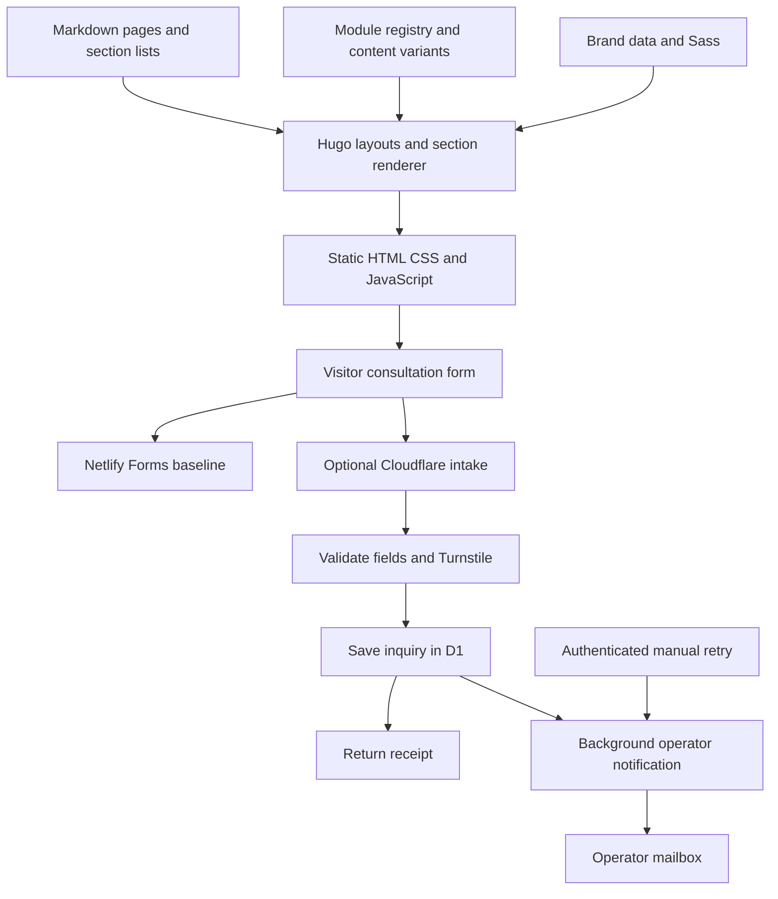

# Binyled’s Storyscape project review and enhancement proposals

**Historical review snapshot.** Implementation has since changed. Use [the remediation record](remediation-2026-10-03.md) and [readiness ledger](readiness.md) for current status; findings below retain the original evidence and line references.

Reviewed October 3, 2026 for Ryan. Source baseline: `main` at `b834acbdd82df9f85b32b2a84f8be8d847679264`. The working tree was clean when the review began. This document records findings and proposals; it does not implement them or establish production readiness.

**The assessment.** Storyscape is a substantial custom Hugo service website with a useful modular foundation and a thoughtfully designed optional inquiry backend. It is strongest at presenting a private game-mastering service. It is not yet a general professional TTRPG toolkit: its reusable components still depend on one brand, its business resources are prose rather than working tools, and its operator workflow requires manual database work. The best next direction is to make it a complete, accessible reference kit for presenting, preparing, and operating a professional GM practice, with Storyscape retained as a concrete example.

The proposed scope centers on the existing website and practice toolkit. Campaign and session tools appear as optional later extensions. “Kitchen sink” should describe the available library and complete example workflows. Individual published sites should select the pieces appropriate to their audience.

This review contains **24 correction findings and 36 enhancement proposals**, with solutions and acceptance criteria. Priority reflects practical impact, not a claim of an exhaustive security audit. P1 means resolve before relying on the affected external workflow; P2 means correct in the foundation/exemplar pass; P3 means a lower-impact consistency improvement. Proposed enhancements are not current functionality or approved business commitments.

**What was examined and verified.** The review covered the 129 tracked files through source inventory and inspection of content, configuration, templates, scripts, styles, backend, tests, migrations, workflows, brand material, and operational documentation. There are 15 Markdown content files, including the draft workshop; the release has 14 content HTML pages plus the 404 page. The module registry has 18 entries: 16 reusable sections and two deliberately restricted scaffolds. There are three hero directions and two service collections.

A fresh production-mode build into a temporary directory passed the existing HTML audit on local Hugo Extended 0.166.0. Five selected intake and frontend tests passed on Node 22.22.3, covering durable receipts, duplicate retries, verification failures, network uncertainty, and blocked session storage. Desktop and 390 × 844 mobile browser inspection covered the homepage, mobile menu, consultation page, light theme, and brand-guide search/navigation. An isolated incomplete-variant build, source-color calculations, and inspection of generated static assets established additional findings below.

The full suite, GitNexus analysis, Wrangler runtime, live Turnstile challenges, live form submissions, email delivery, remote CI state, DNS, production hosting, assistive-technology acceptance, backup restoration, and actual client operations were not verified in this review. Historical verification statements in existing documents are evidence of what was recorded then, not fresh acceptance results. No email was sent, and no account, database, deployment, or Git publication state was changed.

**The current project in practical terms.**

| Area | Current capability | Assessment |
| --- | --- | --- |
| Purpose | Consultation-led private GM service in Bentonville/Northwest Arkansas, also used as a modular master | Clear example brand; broader professional-toolkit identity still needs definition |
| Public content | Experience, services, illustrative adventures, gatherings, host guide, process, fit, about, questions, inquiry, privacy | Broad coverage, but many practical answers remain undecided and some pages repeat the same promise |
| Presentation | Custom Sass, self-hosted fonts, dark/light themes, responsive grids, decorative motion | Coherent editorial design; specific accessibility defects and interaction gaps remain |
| Composition | Data-driven section order, IDs, enable/disable, complete content variants | Good starting engine; not a validated general-purpose component contract |
| Workshop | Draft-only module showcase with search and variant previews | Useful component browser; does not save or export compositions |
| Brand tools | Searchable/printable HTML guide, copy buttons, checklist, production bible and writing skill | Rich reference material; operationally public, and partly duplicated |
| Netlify inquiry | Native form markup, honeypot, host configuration | Baseline implementation; actual capture/notification configuration unverified |
| Cloudflare inquiry | Bounded parsing, validation, Turnstile, D1 storage, retry identity, email notification lease | Strong durability design; REST request mismatch and operational acceptance gaps |
| Operator workflow | Gmail notification, D1 dashboard queries, one-ID notification recovery command | Functional building blocks; significant manual effort, no dedicated operator UI |
| Scheduling/payment | Workshop-only booking scaffold | No connected calendar, availability, reservation, invoice, deposit, or payment workflow |
| Session resources | Three illustrative adventure hooks and advice documents | No playable adventure packet, session runner, character library, or campaign manager |
| Delivery/quality | Hugo build, HTML audit, module build fixtures, intake mocks, hosting-output tests, GitHub Actions | Useful checks with important blind spots; no comprehensive accessibility or live-provider proof |
| Reuse/distribution | Editable repository and sculpting guide | Rebranding takes many edits; root reuse/license policy and upgrade path are undefined |

**How the architecture works.**

The public site is assembled at build time. `hugo.yaml` supplies settings and primary navigation. Markdown front matter selects layouts and, on modular pages, an ordered section list. `data/modules.yaml` maps section names to partials. `data/home.yaml` supplies the default section content; `data/variants.yaml` supplies complete replacements. The renderer selects data, checks module names and section IDs, blocks showcase-only modules from public composition, and calls a section partial. Shared page layouts, header, footer, and head complete the HTML. Sass is compiled and built assets are fingerprinted with integrity metadata.

Browser JavaScript adds navigation, theme switching, brand-guide operations, workshop filtering, and the optional Cloudflare inquiry experience. It is deliberately small and does not require a client framework. The package declares no npm dependencies, so the absence of a dependency lockfile is not itself a defect.



On Cloudflare, `/api/consultation` rejects unsuitable methods, origins, content types, bodies, fields, selections, dates, consent versions, and verification results. It stores a UUID and canonical payload hash using parameterized SQL. A repeated UUID with matching details returns the same inquiry; conflicting details return 409. Storage precedes the visitor receipt. Notification attempts use a 60-second lease and separate status. This is a sound distinction between an inquiry being saved, a provider accepting mail, and a person receiving or answering it.

GitHub Pages is configured as a static staging mirror with noindex, no sitemap, and a disabled form. Netlify is the baseline configured production target. Cloudflare is an opt-in target with separate build and runtime settings. These are repository configurations; they do not prove which hosts are currently live.

**What deserves to be preserved.**

- The host-centered service promise gives the example a recognizable purpose.
- Fabricated testimonials, availability, biography, and prices are deliberately avoided in public modules.
- The library uses native HTML and small scripts rather than imposing an unnecessary application framework.
- Draft workshop isolation, unique section IDs, clean output builds, subpath awareness, and non-indexable previews show useful attention to publishing boundaries.
- Inquiry persistence is independent of notification success. Sensitive free text is omitted from operator notification emails.
- Parameterized SQL, field allowlists, duplicate-field rejection, actual streamed body limits, fixed operator recipients, and stable error codes are good foundations.
- The operating guide explicitly recognizes unresolved deployment, backup, retention, and mailbox acceptance work.
- The existing tests exercise meaningful failure behavior. Preserve these while correcting their limits.

**Corrections with evidence and proposed solutions.**

1. **C01 — P1 — Correct the Cloudflare email request contract.** `lib/notifications.mjs:26` serializes `replyTo`, and `tests/intake.test.mjs:57` asserts that same property. The current Cloudflare REST API specifies `reply_to`; the request is sent directly to REST, not through the Workers email builder. The implementation therefore does not establish the promised Reply-To behavior; provider rejection or ignoring the unknown field must be treated as possible until tested. Change the transport field, add an independent fixture based on the REST schema, and retain the separate delivery state. **Accept when:** the contract test rejects `replyTo`, accepts the documented payload, and a separately authorized preview email shows the correct Reply-To. [Cloudflare REST schema](https://developers.cloudflare.com/api/resources/email_sending/methods/send/).

2. **C02 — P1 — Retire hazardous historical operating instructions in place.** `docs/site-operations.md` says the peripheral plan is historical, but `docs/site-peripheral-plan.md:3` still introduces itself as the implementation specification. Its purge SQL at line 139 selects by creation age without checking lead closure, despite the surrounding promise to purge closed inquiries. Its preview table at line 508 recommends dummy verification keys, which current code rejects on deployed sites. Its schema, environment names, notification states, export command, and rollback assumptions also differ from implementation. Add a prominent superseded notice and link to the authoritative runbook; remove executable obsolete recipes or move them to an unmistakable archive. **Accept when:** every operational entry point leads to current instructions, and no recommended purge selects open inquiries.

3. **C03 — P1 — Reconcile marketing with the actual consent promise.** `docs/marketing-campaign.md:56` recommends adding every inquiry to availability mail, including non-bookers. The consultation checkbox authorizes responding to the request, and `content/privacy/index.md` requires separate consent for unrelated marketing. This is a definite internal policy conflict; no claim is made that such mail has actually been sent. Remove automatic enrollment. If availability mail is wanted, use an optional, separate subscription choice and a recorded withdrawal path. **Accept when:** an inquiry can be processed without marketing enrollment, and every availability recipient has an appropriate separate basis recorded.

4. **C04 — P2 — Fix contrast across interaction states and fixed-color sections.** Dark primary-button text `#fffaf0` over hover background `#338c76` calculates to about **3.92:1**; default is about 5.09:1. The button text is small, so the hover value is below the normal-text AA threshold. Theme-global focus colors also conflict with fixed parchment/forest sections: the source pairs calculate to about 1.48:1 and 1.61:1. Light-theme gold over the forest base calculates to about 1.92:1; composited gradients need checking in the actual component. Introduce foreground/focus tokens for each surface and verify hover, active, and focus states. **Accept when:** actual foreground/background combinations pass their applicable criteria in both themes, including fixed-color sections. The source calculations establish specific issues, not a whole-site conformance result. [W3C contrast guidance](https://www.w3.org/WAI/WCAG22/Understanding/contrast-minimum.html).

5. **C05 — P2 — Add real module content validation.** `layouts/_partials/sections/render.html` validates module existence, variant existence, restrictions, and IDs, but not required content fields or row shapes. An isolated `hero` variant containing only an eyebrow built successfully and passed `audit_site.py`, leaving essential hero content absent. Define required fields, allowed types, nonempty text, link destinations/labels, image metadata, and table dimensions per module. **Accept when:** the incomplete-hero fixture fails with a useful field path before publication; valid minimal and full fixtures pass. Until then, change the roadmap’s “schema validation” claim to describe the narrower checks.

6. **C06 — P2 — Exclude working artwork from release output.** `.gitignore` excludes `static/images/temp/`, but Hugo copies it because it is inside `static/`. The fresh local build included six PNGs totaling **8,742,582 bytes** under `/images/temp/`. A clean Git checkout would not contain these ignored files; local releases currently differ. Move source artwork outside public static roots or explicitly exclude it, then audit the output manifest. **Accept when:** both a clean checkout build and a normal local build publish only intended assets. This is an observed output-boundary defect, not evidence of an external leak.

7. **C07 — P2 — Align the declared Node requirement with the tests.** `package.json:16` allows Node 20, while the tests import `node:sqlite`, which was added in Node 22.5 and became available without its experimental flag in 22.13. State Node 22.13+ for the current verification workflow, or deliberately provide an alternative. Add a short prerequisite check and a version file. **Accept when:** the declared minimum can run every documented default command, and unsupported versions fail with a useful message. [Node SQLite history](https://nodejs.org/api/sqlite.html).

8. **C08 — P2 — Make build command descriptions accurate.** README describes `build:cloudflare` as assembling and auditing the bundle. `scripts/build-cloudflare.mjs` validates build inputs and invokes Hugo; it does not call the HTML audit or compile/execute the Pages Functions. Hosting checks separately inspect HTML. Name these steps precisely or chain the promised audit. **Accept when:** documentation and exit behavior agree, and “deployment verified” cannot mean only “static HTML generated.”

9. **C09 — P2 — Replace broad readiness claims with scoped evidence.** `roadmap.md:15` presents WCAG AA accessibility as complete. The current checks do not establish that, and C04 identifies a contrast defect. “Verified Cloudflare Intake Architecture” should distinguish local mocked contracts from real provider acceptance. Use statuses such as implemented, locally checked, preview verified, and operationally accepted, with dates and evidence. **Accept when:** every readiness assertion has a stated scope, and external acceptance remains visibly unresolved until performed.

10. **C10 — P2 — Repair the documentation map and deployment facts.** README points to nonexistent `lib/intake-core.mjs` and `lib/notification.mjs`; the actual files are `lib/intake.mjs` and `lib/notifications.mjs`. Hosting prose says Netlify “is the site” and that the placeholder never reaches a visitor, while plain `npm run build` retains the placeholder canonical domain. The hosted Hugo pin is 0.164.0; the local runtime is 0.166.0. Correct paths, distinguish configured targets from observed deployment, and distinguish local preview builds from release builds. **Accept when:** documented paths exist, release commands require the intended origin, and version support is explicit.

11. **C11 — P2 — Reconcile pricing assumptions and the booking sequence.** `docs/pricing.md` says to obtain current comparables but also gives unsourced market ranges and claims what local buyers routinely pay. It describes named packages, durations, and group sizes as aligned with public data when the current comparison uses different names and deliberately omits those facts. “Deposit at consultation” also needs reconciliation with the public no-obligation consultation promise. Convert numbers to dated research records or labeled hypotheses; define discovery → proposal → acceptance → deposit/date confirmation consistently. **Accept when:** no estimate is presented as market evidence or an approved offer, and public/internal descriptions agree.

12. **C12 — P2 — Make the brand guide’s audience deliberate.** `/brand-guide/` is noindex but shipped and linked in the public footer. It exposes audience targeting, internal standards, unresolved launch decisions, and governance commentary. That is useful in an exemplar, but questionable in a client-facing service site. Add an explicit documentation/demo profile and an independently selectable public brand summary. **Accept when:** the professional reference site can show the full guide while a client site omits internal strategy. Noindex must never be described as access control.

13. **C13 — P2 — Make ordinary site storage as resilient as intake storage.** `layouts/_partials/head.html` reads localStorage without a guard. `assets/js/site.js:41` and line 166 write without guards; parsed checklist state is not checked to be an object. Restricted storage can interrupt label/progress updates, and a stored JSON `null` can break checklist initialization. Add safe storage helpers and validate state shape. **Accept when:** theme and checklist remain usable with blocked storage, malformed JSON, null values, and failed writes; persistence is optional.

14. **C14 — P2 — Repair brand-guide navigation after filtering.** Reproduced in the browser: search for `Manrope`, then select Foundation. The URL changes to `#guide-foundation`, but the section remains hidden. The workshop already clears its filter on section navigation; the guide does not. Clear/reconcile search on navigation and hash changes, reveal the destination, and preserve sensible focus. **Accept when:** every visible section link reaches readable content after a filter, including direct fragment navigation.

15. **C15 — P2 — Implement the documented appearance preferences.** `data/brand.yaml` promises respect for system light/dark preferences, but the site defaults to dark and only restores a saved light preference. There is no system appearance path. Add System/Light/Dark behavior and a site-wide Reduce motion control. Existing OS reduced-motion CSS is useful, but continuous decorative motion still merits explicit user control and criterion-specific review. **Accept when:** initial appearance follows the selected policy, OS changes work in System mode, and all ambient/scroll motion can be stopped without hiding essential content. [W3C motion-control guidance](https://www.w3.org/WAI/WCAG22/Understanding/pause-stop-hide.html).

16. **C16 — P2 — Connect form help and errors to controls.** The vision and accommodation help paragraphs have no IDs or `aria-describedby` links; this was confirmed in rendered markup. Server errors are global strings rather than field-linked feedback. Add persistent help IDs, stable machine-readable error codes, field errors, `aria-invalid`, and a focusable summary. **Accept when:** users can identify, reach, and correct each failed field by keyboard or assistive technology without reentering unaffected answers.

17. **C17 — P2 — Strengthen receipt and conflict handling.** `assets/js/intake.js` accepts any successful JSON response with `ok: true`, including one with no inquiry ID, and clears retry state. The tests permit this. It also treats consent-version and changed-payload conflicts as the same status with limited recovery choices. Require a valid receipt matching the submitted request, with an explicit separate contract for honeypot handling; return distinct error codes for conflict types. **Accept when:** malformed, missing, or mismatched receipts retain recovery state, and notice changes can be resolved without a new ambiguous submission.

18. **C18 — P2 — Provide a contact alternative for every active intake mode.** Only Cloudflare markup renders the fallback email. The Netlify baseline relies entirely on the provider form; the baseline privacy note tells people to ask for correction/deletion after receiving a reply. Make configured contact details independent of backend choice and visible before form completion. **Accept when:** someone unable to use the form or still awaiting a reply has a clear direct route in every intended production profile.

19. **C19 — P2 — Reduce operator effort and preserve recoverability.** The current runbook requires checking D1 manually, writing lifecycle SQL, and retrying notifications by UUID. The visitor retains form contents only while the page stays open; reload remembers an ID/hash, not their prose. These are documented limitations, but they impose avoidable effort on users with limited typing capacity. Provide an accessible operator inbox and an explicit Copy/Download draft recovery option; evaluate opt-in expiring draft storage separately, without silently persisting sensitive notes. **Accept when:** ordinary review/contact/closure/retry work needs no SQL or UUID transcription, and a visitor has a clear recovery path that respects their privacy choice.

20. **C20 — P2 — Complete the reuse and asset provenance record.** Third-party font and PaperMod notices exist, but no root project license specifies intended reuse of original code/content. The asset register covers the social card, seal, fonts, and favicons but not the six WebP scene assets. Image-plan prompts are not a provenance record or proof of approval. Separate code, brand, written-content, and image reuse terms; record source, creation method, permission/status, and intended usage per asset. **Accept when:** a professional can determine what they may adapt and what needs replacement without assuming rights or approval.

21. **C21 — P2 — Replace public production commentary with useful facts.** The About page explains that the website does not publish unverified biography; the Questions lede talks about not inventing details; privacy text tells the owner what “should” be configured. These are editorial instructions visible to clients. Keep the honesty controls internally, then publish approved facts, a simple introduction, and actual operating practices. **Accept when:** client pages answer who, what, where, how, and next steps; unresolved facts remain honestly absent without exposing drafting instructions.

22. **C22 — P2 — Correct the assurance gaps in the checks.** `audit_site.py` checks heading counts but not nonempty headings; it skips label validation for controls without IDs and ignores absolute HTTP(S) links even when they point to the same site. The Python module/hosting gates use `assert`, which can be disabled by optimized Python. Several expectations hardcode Storyscape routes, section counts, and phrases. Replace safety-gate asserts with explicit failures, separate fixture expectations from general invariants, and add negative controls for each promised check. **Accept when:** intentionally empty essential content, invalid accessible names, bad same-origin links, and optimized-Python bypass attempts fail appropriately, while valid alternate site compositions remain possible.

23. **C23 — P2 — Verify environment and deployment boundaries independently.** The templates infer a static mirror from `staging` plus non-Cloudflare, so Netlify previews also disable intake. Cloudflare’s visible “separate test requests” promise depends on correct dashboard bindings, not a schema marker in each database. Static `_headers` and Netlify headers are maintained separately. Make host target, publication environment, and intake capability explicit; add a database environment marker checked by runtime; verify deployed headers/functions using the correct host. **Accept when:** preview cannot operate against a production-marked database, the intended preview capabilities are documented, and the built Pages Function routes are exercised before cutover. No current misbinding is alleged.

24. **C24 — P3 — Centralize field rules and business constraints.** Field options and constraints are repeated across HTML, backend, tests, and prose. The browser sets a minimum preferred date to today; the backend only validates that the date exists. A minimum of two guests is hardcoded while the actual supported range remains an owner decision. Create a shared field definition and separate technical constraints from approved service policy. **Accept when:** browser/server behavior agrees, “not sure yet” paths are intentional, and changing a policy does not require synchronizing several unrelated files manually.

**Content and documentation assessment.**

The copy has a consistent hospitality voice and avoids presenting imaginary client stories as evidence. The three adventure premises offer distinct tones and player choices. The host guide is practical, and the statement that diagnoses are unnecessary is worth preserving. The main weakness is that the site is often more specific about atmosphere than about the actual person, service boundaries, preparation, or next step. Many FAQ answers amount to “we will discuss it.” That is an honest interim state, but it leaves the consultation carrying nearly every decision.

There are also several overlapping taxonomies: three core service cards, six extended discussion formats, three comparison columns, three process-page story directions, and three illustrative adventures. Each is individually understandable; their relationship is not modeled. A clear separation between service format, occasion, adventure concept, and actual offering would improve both visitor understanding and maintainability.

The business playbooks contain useful ideas about preparation time, scope, return clients, and referrals, but often present untested judgments as universal facts: demand is assumed sufficient, discounting is categorically rejected, guest preferences are generalized, and capacity patterns are prescribed without measured evidence. Recast these as selectable operating hypotheses. A professional reference kit should accommodate hobby use, occasional paid facilitation, and different practice models without assuming a particular commercial outcome for Ryan.

Documentation is extensive but lacks a single authority map. README, roadmap, project card, brand data, production bible, historical peripheral plan, and current operations guide overlap. The current operations guide is the strongest operational source; the historical plan is the most consequential drift risk. Put current instructions, rationale, examples, historical material, and outstanding owner decisions in distinct places. Local source paths and obsolete references to numbered personal “instincts” should be replaced by self-contained reasoning.

**Enhancement proposals for the reusable foundation.** These are new capabilities. Small means a focused component/document change; medium means several coordinated files or an interface; large means a new workflow/data model or integration. They are relative scope labels, not delivery estimates.

| ID | Proposal and intended result | Solution shape | Acceptance criterion | Scope |
| --- | --- | --- | --- | --- |
| E01 | Named site profiles | Add `showcase`, `private-gm`, `online-gm`, and `community-facilitator` compositions; retain Storyscape as the first complete example | Each profile builds with its own routes/content and no stray profile-specific claims | Medium |
| E02 | Central site identity | Move name, monogram, author, locations, contact, footer, CTA language, and structured-data identity into validated site data | Rebrand an example by editing configuration/content, without template surgery | Medium |
| E03 | Distinct content models | Model service formats, offerings, occasions, adventure concepts, people, resources, and policies with stable IDs | One item has one authoritative record and can appear consistently in cards, pages, and inquiry context | Medium |
| E04 | Shared schemas and field definitions | Add lightweight build-time validation; generate or share constants across the form and backend where practical | Invalid examples fail with a field path; valid examples produce the same semantics across surfaces | Medium |
| E05 | Low-input composition workflow | Provide short local commands and a keyboard-friendly selector with preview/export of section YAML; include undo and presets | Ryan can choose a preset and make ordinary edits without copying long paths or retyping configuration | Medium |
| E06 | A complete component workshop | Show empty, short, long, error, loading, unavailable, dark, light, and narrow-screen states, plus each component’s data contract | Adding a module registers both its implementation and representative states; no separate hardcoded showcase list is needed | Medium |
| E07 | Independent content and visual variants | Separate copy selection from appearance tokens and layout options | A service can change tone or layout without duplicating its business facts | Medium |
| E08 | Upgradeable starter boundary | Keep reusable implementation separate from example content, with documented version/migration rules | A copied specialist site can receive a core fix without overwriting its identity and local content | Large |
| E09 | Practical developer onboarding | Add prerequisite diagnostics, a short architecture map, one module-authoring example, and change-to-check mapping | A new maintainer can add a validated section and run only the relevant checks from the guide | Small |

**Enhancement proposals for professional TTRPG content.**

| ID | Proposal and intended result | Solution shape | Acceptance criterion | Scope |
| --- | --- | --- | --- | --- |
| E10 | Practitioner profile | Add an approved introduction, delivery style, selected experience, languages, and suitability information | Every factual claim is attributable to supplied owner material; absent credentials stay absent | Small |
| E11 | Useful service fact sheets | Use optional owner-approved duration, group fit, setting, format, inclusions, access arrangements, and quote basis | Visitors can assess practical fit without interpreting decorative copy or assumed ranges | Medium |
| E12 | Playable reference adventure | Expand one existing concept into a complete system-neutral packet: premise, scenes, choices, clues, pacing, NPC motives, endings, and materials | Another GM can run it from the packet; its review/playtest status is explicit | Medium |
| E13 | An adventure catalog with real metadata | Add tone, expected preparation, format, content notes, accessibility adaptations, materials, and status | Catalog filters distinguish illustrative ideas, runnable drafts, tested material, and offered services | Medium |
| E14 | Session-zero and participation kit | Supply a group agreement, content-preference prompts, private feedback route, pause procedure, and optional debrief | A group can choose how to participate without diagnoses, forced disclosure, or an assumption that one safety technique suits everyone | Medium |
| E15 | Host and player handouts | Produce short printable/HTML guides, a “what happens at a TTRPG table” example, glossary, and no-homework quick start | The material is usable on mobile, in print, and by someone entirely new to roleplaying | Medium |
| E16 | Remote, venue, and event adaptations | Provide configurable checklists for online play, public venues, multiple tables, time zones, audio, and technical fallback | Each extension states prerequisites and limitations and does not silently become a Storyscape service promise | Medium |
| E17 | Evidence-backed case studies | Model client permission, exact approved quote, event context, allowed attribution, and withdrawal status | Only approved material enters public trust components; sample stories remain clearly labeled | Medium |
| E18 | Resource and rights library | Organize reusable materials by purpose, author, version, system, source/license, and permitted distribution | A GM can find the correct resource and its reuse terms; protected rules text is not imported by assumption | Medium |

**Enhancement proposals for the operator toolkit.** The aim is to reduce repeated typing and decision load. None of these proposals authorizes sending messages, taking payments, or contacting anyone.

| ID | Proposal and intended result | Solution shape | Acceptance criterion | Scope |
| --- | --- | --- | --- | --- |
| E19 | Accessible inquiry inbox | Add an authenticated operator surface or small local command interface for view, filter, contact, close, reopen, and retry | Routine operations need no SQL; destructive operations identify the exact records and remain deliberate | Large |
| E20 | Inquiry-to-session workflow | Track inquiry, qualified, proposal, accepted, scheduled, completed, and closed independently from notification status | Each transition has a reason/history and does not infer a booking from a successful email | Large |
| E21 | Scope and proposal generator | Turn approved inquiry facts into a reviewable scope, inclusions, exclusions, timing, responsibilities, and quote draft | The operator can edit and export a complete proposal without duplicating client details manually | Medium |
| E22 | Preparation and capacity calculator | Count consultation, prep, travel, setup, delivery, follow-up, administration, hard costs, and chosen recovery buffer | Outputs expose assumptions, support uneven capacity, and do not pretend to validate market demand or benefits eligibility | Medium |
| E23 | Calendar and payment handoffs | Add optional adapters only after scope is accepted; handle time zones, rescheduling, provider errors, and duplicate webhooks | Actual reservation/payment state is verified independently; the static scaffold never implies availability | Large |
| E24 | A bounded session preparation packet | Generate an outline, materials checklist, setup/pack-down list, player accommodations summary, and final preparation check | One chosen session produces a coherent packet with minimal repeated input | Medium |
| E25 | Optional session companion | Offer offline-capable scene notes, pause/break reminders, spotlight prompts, and session summary capture | A GM can pause/resume and export notes; no network, AI provider, recording, or full VTT is required | Large |
| E26 | Follow-up drafts and permissions | Create editable thank-you, feedback, recap, referral, and quote/photo permission templates with short reusable codes | Every output remains a draft until explicitly sent; marketing and publication permissions stay separate | Medium |
| E27 | Quiet operational recovery | Provide bounded retries with backoff, stale-inquiry visibility, and notification of actionable failures only | Unchanged state produces no noise; retry caps and final failures are visible; stored inquiries remain intact | Large |

**Enhancement proposals for access, quality, and maintainability.**

| ID | Proposal and intended result | Solution shape | Acceptance criterion | Scope |
| --- | --- | --- | --- | --- |
| E28 | A shorter first inquiry | Put the first useful field near the top; start with name/contact and a brief request, then make detail optional or progressive | A visitor can begin without writing an elaborate vision; either route reaches the same valid inquiry model | Medium |
| E29 | Accessibility as an explicit operating mode | Add motion control, system appearance, comfortable reading, stable focus, large controls, voice-compatible labels, and draft recovery | Core tasks work with keyboard, zoom/reflow, reduced motion, and representative assistive technology; limits are documented | Medium |
| E30 | Portable, useful exports | Provide printable HTML and straightforward Markdown/JSON/CSV exports for appropriate resources; keep sensitive records private | Exported artifacts retain context/version/rights, omit unrequested sensitive fields, and remain usable without the site | Medium |
| E31 | Real-browser regression checks | Add a small representative set for navigation, filters, theme/storage failure, form errors, retries, print, and narrow layouts | Meaningful failures reproduce in a browser; automated checks are not labeled conformance certification | Medium |
| E32 | Provider and runtime contract tests | Validate outbound mail against the actual REST schema and run Pages Functions/D1 through the intended runtime in preview | A passing test cannot rely solely on mocks that repeat the implementation’s mistaken field names | Medium |
| E33 | Output and performance budgets | Audit published file paths; set modest CSS/JS/image budgets; add image dimensions and responsive image delivery | Unapproved source assets fail the build; representative pages avoid preventable layout shifts and oversized downloads | Medium |
| E34 | Privacy and security operations | Add environment checks, narrow operator authorization, request-rate controls appropriate to the host, retention previews, and restore procedures that respect purges | Preview/production isolation and recovery are demonstrated; rate controls do not indiscriminately block shared-network users | Large |
| E35 | Content quality and discovery | Unify FAQ facts, give resources descriptive titles/URLs, generate accurate metadata, and add breadcrumbs/search when the library grows | Information is findable and consistent; structured data contains only actual services and approved facts | Medium |
| E36 | An evidence and release ledger | Record supported versions, current check results, provider acceptance, known limits, changed files, and next decisions per release | A maintainer can answer “what is verified at this revision?” without reading historical chat or running every test again | Small |

**A practical target architecture.** Keep Hugo as the public publishing layer. Introduce a validated data layer for identity, offers, policies, resources, and components. Keep the browser interaction layer small. Keep Netlify and Cloudflare intake behavior behind explicit capability/configuration choices. Add private operator capabilities only when their workflows justify them; do not place credentials or client records into Hugo data or a static admin page. Put all external messages, reservations, and payments behind deliberate operator actions and truthful status handling.

Data should flow from one approved fact to its appearances across the site and toolkit. For example, an offering record should drive its card, detail page, inquiry context, preparation defaults, and proposal language. Its published status should be distinct from whether a booking provider is configured. Adventure content should have its own rights/review/playtest state. Inquiry lifecycle, notification lifecycle, and booking/payment lifecycle should remain separate records or clearly separated state machines.

The current code is small enough that a wholesale framework migration would add work before solving these problems. Start with explicit data contracts, small modules, and reliable operator interactions. A plugin system, multi-tenant SaaS platform, custom payment processor, full virtual tabletop, or mandatory AI workflow should be an independently justified future project, not a prerequisite for this exemplar.

**Suggested sequence and completion criteria.**

| Sequence | Work | What completion means |
| --- | --- | --- |
| 1 — Correct the foundation | C01–C11 first, with C13–C18 alongside the affected frontend work | Mail contract matches provider docs, obsolete instructions cannot be mistaken for current ones, consent agrees, critical content is validated, unintended assets are excluded, and runtime/quality claims are accurate |
| 2 — Make a reusable exemplar | E01–E09 plus C12, C20–C24 | Storyscape and one substantially different specialist profile build from the same components without template edits for identity or hidden assumptions |
| 3 — Deliver one complete professional workflow | E10–E15, E19–E22, E24, E26, E28–E30 | A sample inquiry can become a reviewed proposal, preparation packet, usable session resource, and follow-up draft with minimal reentry |
| 4 — Prove reliability in the intended environment | E31–E36 and authorized provider acceptance | Representative browser, runtime, mail, isolation, backup/restore, and operator recovery evidence is attached to the actual revision |
| 5 — Expand only where useful | E16–E18, E23, E25, E27 | Each added format or integration removes a demonstrated friction and remains optional for smaller sites |

The first complete reference workflow can use **The last light of Lantern Bay**, an existing illustrative concept. Label every example client and event as synthetic. Show its catalog entry, sample consultation, scope draft, preparation packet, printable player introduction, scene outline, and follow-up draft. This would demonstrate how the pieces work together much more convincingly than adding many unrelated widgets. It would still require actual editorial review and playtesting before claiming the adventure is tested.

**Bounded verification plan.** Map each change to the relevant check: module/data changes to the module checks and invalid-content fixtures; backend changes to selected intake/provider-contract cases; hosting changes to the affected output/runtime profile; frontend changes to a short browser task sequence. Run the full release gates once near the end of a substantial integration pass. Existing complete commands, for Ryan to run when wanted, are:

```sh
npm run check && npm run test:intake && npm run test:hosting
```

These commands do not establish live-provider, mailbox, assistive-technology, or restore acceptance. Keep those as discrete, authorized exercises with recorded results. Useful additional regression cases include missing/wrong receipt IDs; stale consent versions; script-load and token-refresh failure; blocked/malformed browser storage; navigation to filtered content; long and incomplete module data; fixed-color surface contrast; optimized-Python gate behavior; and exact output allowlists. Cloudflare tokens are short-lived and single-use, so concurrent-request mocks should not imply the same token can repeatedly pass verification. [Cloudflare token validation](https://developers.cloudflare.com/turnstile/get-started/server-side-validation/).

**Decisions to leave with the owner.** The report proposes architecture and workflows, not rates, qualifications, capacity, public service promises, retention duration, licensing grants, or a deployment target. Resolve these one at a time when their implementation is ready: intended toolkit audience and profiles; actual Storyscape operating facts; code/content/brand reuse terms; preferred host and operator surface; and the data-retention/recovery policy. No commercial expansion is assumed for Ryan personally merely because the exemplar is intended to help TTRPG professionals.

**Recommended first implementation scope.** Correct the mail contract, quarantine the obsolete runbook, reconcile consent/pricing/readiness text, add module schemas and an output allowlist, repair theme/filter/contrast/form recovery, and make site identity configurable. Then build one second profile and one complete sample professional workflow. This yields a coherent exemplar whose claims, documentation, user experience, and implementation agree before its feature catalog grows further.
