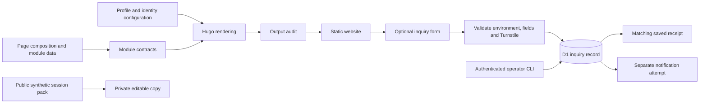

# Binyleds project review and professional toolkit proposals

**Historical review snapshot.** The findings and verification below describe the
October 5 checkout. See [readiness](readiness.md) for later evidence and issues
still open.

Review date: October 5, 2026. Baseline: `main`, HEAD `b834acbdd82df9f85b32b2a84f8be8d847679264`, plus the working tree present at the start of this review: 53 modified tracked files and 57 untracked files. Nothing was staged. This report is the only project file added by the review; application source was not changed.

**Overall judgment.** Storyscape has a coherent visual identity, a useful modular publishing foundation, careful inquiry persistence, and a substantial first session example. It is an emerging toolkit for game masters and people adapting their websites. It is not yet an integrated professional working tool: important steps still require navigating files, reconstructing context, and manually moving information between inquiry, scope, preparation, and delivery. The current release commands also fail, and one new regression fixture is invalid. Correct those foundations before increasing the feature count.

The strongest direction is a small, accessible workbench that carries a practitioner from an inquiry to a reviewable scope, private session preparation, player materials, and follow-up. The existing Hugo website can remain its public presentation layer. This does not require Ryan to operate a commercial service; professional usefulness and personal accessibility are compatible goals.

**What the project currently contains.**

| Part | Current implementation | Practical limit |
| --- | --- | --- |
| Public website | Theme-free Hugo layouts, self-hosted fonts, SCSS, small JavaScript scripts, metadata, navigation, FAQs, host guide and consultation presentation | Primarily a hospitality-oriented service website; a visitor cannot operate a session workflow here |
| Module library | 18 registered modules, 16 sections on the exemplar homepage, three hero directions and two service collections | Composition is edited in source; workshop filtering does not create or save a composition |
| Profiles | Full Storyscape exemplar, client-facing Storyscape, fictional remote Wayfarer Table | Reuse is demonstrated, but some copy, illustrations, routes, assets and form language remain shared or hardcoded |
| Inquiry service | Optional Cloudflare Pages Functions, Turnstile, D1 persistence, matching UUID receipts, payload conflict protection | Real deployed runtime and provider acceptance remain unverified |
| Notifications | Separate background delivery, 60-second claim lease, manual authenticated retry, minimal email contents | No unattended retry; provider acceptance is distinct from mailbox placement |
| Operator tooling | Authenticated list/read/contacted/closed API; numbered CLI selectors with revision protection | No search, next-action date, event history, reopen action, local graphical inbox or session conversion |
| Working materials | Eight-file Lantern Bay pack: inquiry, scope, prep, HTML player introduction, adventure, follow-up, observation sheet and README | One synthetic, unplaytested pack; public remote page does not link to the full material |
| Private working copies | `npm run session` creates an ignored directory with private permissions and starting-file hashes | Copying a pack does not import an inquiry, create a scope record, or track session progress |
| Quality controls | Source checks, output audit, composition checks, SQLite/provider mocks, JavaScript DOM harnesses, hosting-profile checks | Two reproduced gate blockers; test harnesses do not establish live/browser/assistive-technology acceptance |
| Documentation | README, architecture, operations, sculpting, readiness, prior review/remediation, optional practice guides, reuse and asset records | Useful coverage, but fragmented status and some instructions have drifted |

The default content directory contains 15 Markdown pages; the remote example contains 13. The registered trust and booking modules deliberately remain workshop-only. Their absence from public pages is a correct boundary, not evidence of broken booking functionality.

**Architecture from input to outcome.**



The missing connection is between the inquiry record and the private session copy. That connection should become a deliberate, reviewable conversion, not a bulk copy of every private field into a shareable document.

The main ownership boundaries are sensible:

- `hugo.yaml`, `config/`, content front matter and `data/` own identity, composition and copy. `sections/render.html` chooses modules and variants; `sections/validate.html` validates module data before rendering.
- `data/intake.json` owns field lengths, choices and the technical guest-count floor. Hugo and the Cloudflare validator consume it. SQL schema constraints remain versioned migrations.
- `lib/intake.mjs` implements bounded parsing, validation, hashing, persistence and responses. `consultation.js` orchestrates the request. Persistence completes before a successful receipt is returned.
- `lib/environment.mjs` verifies a provisioned database environment marker. Operator authentication is shared by the inbox and notification recovery routes.
- `lib/notifications.mjs` owns delivery claims and provider handling. Inquiry lifecycle, operator revision and notification state are separate concerns.
- `assets/js/intake.js` owns the browser submission and recovery state. It remembers an ID and fingerprint, with an explicit optional private draft file for the actual answers.
- `scripts/inbox.mjs` and `scripts/session.mjs` provide local operator affordances. These should remain thin clients as shared workflow logic grows.

At roughly 3,500 lines across the inspected code, templates, scripts and tests, the project does not need a framework migration to solve its current problems. A shared profile resolver, explicit domain records, smaller browser state helpers and better workflow commands would provide more value than a general plugin system or multi-tenant platform.

**Eight concrete corrections.** Priorities describe when to address an issue: P1 blocks dependable release or creates a materially false active configuration; P2 should be corrected in the next coherent implementation pass. These are current findings, not a restatement of every historical correction.

| ID | Priority and evidence | Problem and consequence | Proposed solution and acceptance |
| --- | --- | --- | --- |
| R01 | P1 — reproduced release failure | `hugo.yaml:83` introduces `module.mounts.excludeFiles`. Both wrappers use `--panicOnWarning`. Default and remote release commands stop on its deprecation warning under installed Hugo 0.166.0. | Use Hugo's supported `files` glob exclusion mechanism while preserving temp-image exclusion. Keep warning failures enabled. Accept when ordinary wrapper builds succeed and the same source passes on pinned Hugo 0.164.0; assert excluded source images remain absent. |
| R02 | P1 — reproduced regression failure | `tests/intake.test.mjs:310` inserts a legacy row without required `experience_level`. The preservation test fails before executing migration 0003, so it neither validates the migration nor permits the intake test gate to pass. | Complete the legacy fixture. Exercise representative lifecycle/notification metadata, compare every column before/after, and test the new count constraint. A separate isolated reproduction with a complete synthetic row passed; that narrows the defect to this fixture, not proof of a production migration. |
| R03 | P1 when remote intake is enabled — reproduced configuration mismatch | `build-site.mjs:11–16` independently permits the remote profile and Netlify backend. The resulting form can have `data-netlify=true`, while `examples/remote/content/privacy/index.md:6` states the form is disabled and collects nothing. | Prefer enforcing disabled intake for the fictional remote profile. If remote live service is desired later, make it a separate capability with backend-aware privacy copy. Accept when incompatible combinations fail before generating output and every active form's privacy statement agrees with its backend. |
| R04 | P2 — reproduced audit bypass | `audit_site.py:156–160` exempts all files under `assets/` and excludes HTML from its asset inventory. An undeclared synthetic `assets/review-synthetic.json` passed the audit. The advertised output allow-list is therefore incomplete. | Permit specifically identified generated CSS/JS outputs and explicitly declared static files; use a separate route policy for HTML. Include harmless negative fixtures under `assets/` and unexpected routes. No actual private-file exposure was found. |
| R05 | P2 — source contradiction, covered by a passing test of the current undesirable behavior | `lib/intake.mjs:98` tells visitors whose privacy version changed to download a draft and reload. `assets/js/intake.js:47` then rejects that draft because its version is old. Recovery requires opening JSON and manually moving answers. | Separate restoration of answers from consent and previous submission identity. Restore compatible answers, clear consent, show the new notice, and explicitly distinguish known pre-storage rejection from an uncertain earlier send. Never silently create a second request. Accept with a version-change round trip requiring no retyping and preserving uncertain-send reconciliation. |
| R06 | P2 — observed in remote rendering | The closing module validates an `eyebrow` but never passes it to the CTA. `cta.html:7,11` retains Storyscape wording and signature. Wayfarer supplies “Continue exploring” but displays “Your evening begins here.” The hero photo and some shared form/footer language are also tied to the original expression. | Parameterize the remaining editorial and presentation fields, pass the declared module fields through, and make signatures optional. Add assertions for distinctive remote copy and absence of unintended Storyscape identity. Do not describe the current profiles as fully generic. |
| R07 | P2 — observed content dead end | “Read the sample adventure” and “Read the worked example” lead to a short remote page that merely names `examples/lantern-bay`. There is no actionable route to the full adventure or player handout. | Render an explicitly public sample resource page and player handout, or provide a working source link if that is the intended destination. Give readers role-specific entry points. Accept when a visitor can reach and use the promised resource without locating a repository directory manually. |
| R08 | P2 — source/documentation drift | `docs/sculpting-guide.md:104–110` directs users to change required routes in `scripts/audit_site.py` and edit templates for identity that is now parameterized. The required routes actually come from `data/release.json`. | Rewrite the adaptation recipe around profile configuration, selected content, module data and release policy. Link remaining genuinely hardcoded items to R06. Accept by following the recipe to create a small derivative without editing the checker to change a route list. |

Hugo documents `excludeFiles` as deprecated since 0.153.0, with `files` as the replacement. The local release failure is directly observed; the exact pinned binary was not run in this review. [Hugo module configuration](https://gohugo.io/configuration/module/#files).

Useful source entry points: [mount configuration](../hugo.yaml), [build profiles](../scripts/build-site.mjs), [migration fixture](../tests/intake.test.mjs), [output audit](../scripts/audit_site.py), [draft recovery](../assets/js/intake.js), [closing module](../layouts/_partials/sections/closing.html), [shared CTA](../layouts/_partials/cta.html), [remote adventure page](../examples/remote/content/adventures/index.md), [adaptation guide](sculpting-guide.md).

**Assessment of the current Git changes.**

The change set contains 1,203 added and 2,346 removed lines in 53 tracked files, plus 57 untracked files at review start. The untracked files are essential parts of the implementation, including the shared JSON rules, new libraries, profiles, migrations, inbox, session pack, schemas, checks and documentation. A tracked-only diff is not the full change set. There were no staged changes.

GitNexus reported 159 changed symbols and nine affected execution flows for the tracked changes, with overall risk **HIGH**. Its index content matched all 158 covered files; an independent hash comparison found no mismatches. The generated AGENTS overview's older symbol/flow counts should not be treated as current inventory. No reindex was needed or run.

The new `assertEnvironment` helper has **HIGH** upstream impact: direct callers are consultation intake, notification delivery and operator authorization, which in turn affect all three API routes. A missing migration or environment marker disables those paths together. This is useful fail-closed behavior, but the deployment order must be tested and documented as an integration requirement. Targeted graph walks for validation, inquiry persistence, delivery, authorization, audit, theme, motion and guide navigation found the expected callers. Graph queries do not replace the template, CLI, configuration and event-handler inspection needed for dynamically connected code.

| Change group | Review assessment | What remains |
| --- | --- | --- |
| Persistence, field rules and receipts | Better contracts: stricter receipt matching, honest honeypot rejection, explicit error codes, shared limits and a positive technical guest floor | Correct fixture; real D1 migration and retry acceptance; clarify consent-version recovery |
| Environment isolation and operator inbox | Appropriate separation of authentication, environment checks, record access and revision-protected status changes | Schema rollout, selector UX, recovery/history, pagination tests and runtime evidence |
| Notification transport | `replyTo` changed to REST `reply_to`; recipient acceptance checks and private-note exclusion remain sensible | Live sender/recipient setup, actual Reply-To and mailbox acceptance, retry observability |
| Browser and accessibility changes | Storage failures handled, system theme and persistent motion control added, input labels/help improved, form moved ahead of aside, matching receipts and explicit drafts added | Actual file round trips, keyboard/error correction, screen reader and browser-matrix acceptance |
| Build and release policy | Backend selection, client-guide exclusion, shared audits and asset declarations are useful | R01, R03, R04; exact pinned build; define one profile/capability policy shared by wrappers and audit |
| Content and documentation | Removal of unsupported rate claims, automatic marketing assumptions and obsolete runbooks improves accuracy | Some useful professional depth was compressed into short prose; restore it as worksheets and usable examples, not unsupported rules |
| Example workflow and reuse | A full synthetic adventure and second identity now exist; private-copy command is useful | Public access to promised samples, controlled personalization, licensing decision and asset provenance |

The provider spelling correction agrees with the currently documented Cloudflare REST request. The response distinguishes delivered and queued recipients. This supports the local contract review, not proof of real email delivery. [Cloudflare email REST contract](https://developers.cloudflare.com/api/resources/email_sending/methods/send/).

Before a later owner-authorized commit, organize the work into reviewable units: build/contracts; inquiry/schema/operator changes; browser recovery/accessibility; profiles/resources; documentation and rights records. Respect dependencies between these units. Capture all required new files explicitly, and inspect the optional generated agent-skill files separately. Do not include private `.local`, exports or credentials. No Git publication action is proposed by this review itself.

**Content and experience assessment.**

Storyscape's strongest editorial choice is its specific hospitality premise: the host gets to participate while someone else prepares and facilitates. Beginner reassurance, scope-before-commitment language, the illustrative-art labels and the separation of inquiries from reservations are coherent. The visual system supports that premise with restrained color, serif display type and consistent components.

The public site repeats the same promise across many sections. Sixteen homepage sections make sense as an exemplar, but a working practitioner's site should choose a shorter composition. A useful default is: clear offer, practical fit, one concrete example, process, practitioner facts, key questions and next action. The full module library can stay in the workshop. A collapsed 320-pixel menu exposes only the monogram for identity; consider a short text name there for first-time visitors.

The About page explains a philosophy rather than who delivers it. That is an honest choice with no supplied biography. If a real practitioner later uses the site, add their actual name, relevant experience, play formats, boundaries and approved evidence. “Everything is discussed privately” prevents invented promises, but can also make a real service unnecessarily difficult to assess. Supply concrete approved fit information when it exists, with ranges or conditions only if the practitioner actually endorses them.

Lantern Bay is the most useful foundation for professional workflow development. It has an explicit truth, three NPC motives, three locations, redundant critical clues, meaningful alternatives, a pacing plan and multiple endings. It accommodates passing, breaks, spoken or written choices and a shorter path. Its limitation is evidence: there is no recorded read-through or playtest. Keep that label accurate. Add a one-page facilitator view, a spoiler-free player route, a clue index and observations from actual use before expanding into many shallow adventure concepts.

The condensed pricing and preparation documents are better aligned with sustainable work than the removed general business prescriptions. Their next improvement should be executable usefulness: a worksheet with assumptions, a scope checklist and an example completed with synthetic inputs. Do not require recurring content campaigns, a client-growth target, or paid operation for this toolkit to count as successful.

**Enhancement register.** These 32 proposals extend or consolidate the earlier E01–E36 backlog. They are opportunities, not 32 defects or a commitment to build everything. “Next” follows R01–R08; “Later” depends on actual use; “Conditional” needs a chosen operational need. Effort is relative: small, medium or large.

| ID | Priority / effort | Opportunity and proposed solution | Acceptance that would make it useful |
| --- | --- | --- | --- |
| E01 | Next / small | Define the toolkit's three modes: author a public site, manage optional inquiries, prepare/run private sessions. Add a short start/resume map. | A returning user can identify the current project, next action and relevant command without reading a long runbook. |
| E02 | Next / medium | Centralize profile capabilities: content roots, module data, backend compatibility, indexing, internal guides, route and asset policies. Share one resolver across build wrappers/checkers. | Every supported profile/backend combination has an explicit allowed or rejected result; R03 cannot recur through a new wrapper. |
| E03 | Next / medium | Separate reusable core, sample identities and private working data through documented folders and stable configuration contracts. | A new identity can be made without copying backend logic or editing shared templates. |
| E04 | Next / medium | Add a keyboard- and voice-friendly composition picker with numbered presets, move-up/down buttons, preview and YAML export. Keep source control friendly output. | A five-section site can be selected, reordered and saved without typing YAML or dragging. |
| E05 | Next / medium | Validate composition entries as well as module contents: unknown keys, boolean `enabled`, valid registry/variant relationships and safe IDs. | Typos such as `enable` or a string `"false"` fail with an actionable file/field error rather than changing output silently. |
| E06 | Later / medium | Add a focused component-state gallery for long titles, larger text, absent optional links, multiple table widths, empty results and error states. | High-use modules remain understandable at narrow widths and unusual content lengths in both themes. |
| E07 | Later / medium | Make visual presets and hero illustration selection configurable; let motion be a deliberate preset choice and honor configured theme defaults. | Two sites can differ in visual treatment and initial preferences without a stylesheet fork. |
| E08 | Next / small | Turn onboarding into a short environment check plus commands for site, sample pack and inbox. Offer aliases and launchers independent of the shell's current directory. | Ryan can invoke a short command or voice shortcut and resume the intended operation without retyping a path. |
| E09 | Next / medium | Create a resource catalog with stable IDs, format, duration assumption, preparation effort, tone, content notes and evidence status. | A facilitator can find a suitable runnable resource, distinguish concepts from complete packs and open its working copy. |
| E10 | Next / small | Split the public example into facilitator, player and workflow entry points. Derive them from the same pack sources. | Each audience gets the right material; player exports exclude facilitator truth and private planning notes. |
| E11 | Next / medium | Add a controlled inquiry-to-session conversion command. Show which fields will be copied and allow omission of private notes. | One inquiry becomes a private workspace without reentry or accidental inclusion of accommodation details in a shareable packet. |
| E12 | Next / medium | Introduce a small versioned session record: pack version, format, schedule/timezone, participants/count, scope reference, next action and status. | CLI and future UI agree on a session's state; absent information stays unknown rather than being guessed. |
| E13 | Next / medium | Generate a reviewable scope draft with inclusions, exclusions, open questions, version history and evidence of actual acceptance kept separately. | Editing a proposed scope never silently marks it accepted, reserved or paid. |
| E14 | Later / medium | Convert the pricing prose into an optional local calculator for labor, direct costs, overhead, uncertainty and actual effort. | Inputs, units and assumptions are visible; a quote can be revised without rewriting the proposal; no rates are supplied as facts. |
| E15 | Next / small | Add a preparation/capacity checklist with must-have, optional and stop-here items; allow flexible recovery time and a shorter session path. | The tool helps reduce effort and finish a usable session when energy is limited. |
| E16 | Next / medium | Add a private next-action field and date, follow-up status, search and notification-failure filters to the inbox. | The operator can find what needs attention with a short command instead of reading every record or using SQL. |
| E17 | Next / medium | Record inquiry status events and add a revision-checked reopen action with a reason; refresh selector revisions after successful changes. | An accidental close is recoverable through the normal tool and the prior history remains visible. |
| E18 | Later / medium | Improve pagination with stable cursors and explicit continuation; distinguish missing records, accepted notifications, active leases and retryable failures. | New arrivals do not cause skipped records, and a retry result tells the operator what to do next. |
| E19 | Later / large | Add a small accessible operator screen if CLI use reveals friction. A local service can retain the bearer secret and expose only the needed local actions; a hosted version needs an appropriate authenticated session design. | Shortcuts and visible controls perform the same shared actions; long-lived operator secrets are not placed in browser storage. |
| E20 | Next / medium | Simplify first contact with a minimal inquiry path and an optional detailed planning step; offer brief or dictated answers. | A person can start an inquiry without writing a long vision statement while the later scope still captures necessary detail. |
| E21 | Next / medium | Improve recovery: R05, clearly labeled local draft format/version, profile identity, field-specific validation, and an accessible mismatch/reconciliation view. | Reload, changed notice, renamed choices and uncertain submission can be handled without repeated copying or lost context. |
| E22 | Next / medium | Provide audience-specific exports: print-friendly player introduction, facilitator prep, scope draft and accessible plain text. Use explicit inclusion lists. | No GM spoilers, private inquiry notes or hidden metadata appear in a player/public export. |
| E23 | Later / medium | Build a small offline session companion with current scene, clue/NPC lookup, pause control and quick private notes. | The facilitator can run the pack without opening many files; failure or loss of connectivity leaves readable materials available. |
| E24 | Next / small | Add accurate follow-up and permission-request templates populated only from approved session facts. Keep drafts separate from sending. | A useful recap or feedback request is prepared with minimal typing and no invented events, reactions or permissions. |
| E25 | Conditional / medium | Add a bounded notification retry queue with backoff, maximum attempts, visible failure and an operator stop/retry control. | Temporary mail failure recovers without daily SQL work; repeated failures remain visible and do not produce unbounded sends. |
| E26 | Conditional / medium | Implement approved retention, export and deletion workflows with a preview of affected records, explicit execution and independent restore rehearsal. | Open records are protected by policy; selected closed records and sensitive copies can be removed consistently; recovery is demonstrated. |
| E27 | Conditional / medium | Add deployment-level request limits and operational health information: error rates, oldest pending notice, last successful delivery, schema/environment status. Exclude inquiry bodies and secrets. | Failures become discoverable before a visitor has to report them; limits are tuned with evidence instead of guessing a business scale. |
| E28 | Next / medium | Add a small real-browser smoke suite for navigation, forms, draft files and recovery; supplement it with actual keyboard, zoom and screen-reader tasks. | Tests exercise native FormData, browser validation, focus, downloads and rendered layout, with assistive-technology results recorded separately. |
| E29 | Next / medium | Verify the exact hosted toolchain and local Pages/D1 bundle. Version the relevant runtime configuration and record provider contract fixtures. | A successful static Hugo build cannot be confused with successful Functions compilation, bindings, migration or delivery. |
| E30 | Later / small | Establish measured asset and rendering budgets; improve social images, responsive images, intrinsic dimensions and unnecessary profile assets. | Representative pages meet chosen budgets; previews are checked on intended sharing surfaces. The current Storyscape social PNG is about 1.64 MB and the remote SVG preview format remains unverified. |
| E31 | Next / medium | Consolidate documentation status into a revision-aware acceptance ledger; replace stale instructions, add practical recipes and verify documentation links. | README, roadmap, operations and remediation records agree on known failures, accepted behavior and unresolved decisions. |
| E32 | Conditional / small to large | Make reuse/distribution deliberate: resolve original code/content licenses, brand permissions and art provenance; define versioned customization points and upgrade notes. Add calendar/payment/VTT integrations only for an actual workflow need. | A recipient knows what may be reused and how to update it; optional adapters preserve independent inquiry, reservation and payment states. |

**Proposed workflow architecture.** Keep the public site, private records and exports separate while sharing their domain logic:

| Record | Owns | Must not imply |
| --- | --- | --- |
| Inquiry | Contact request, private preferences, consent evidence and response lifecycle | Booking, payment or marketing enrollment |
| Scope revision | Proposed inclusions, exclusions, assumptions and changes | Acceptance merely because a file was generated |
| Session | Actual agreed practical plan, pack version, private prep and completion observations | A completed or playtested session before evidence exists |
| Pack template | Reusable story, NPCs, clues, player materials and source version | Permission to redistribute every asset automatically |
| Export | Intended audience, included fields, source versions and output files | That every private field belongs in every document |
| Notification attempt | Claim, timing, result, stable error and provider reference when useful | Client contact or mailbox receipt from a provider queue acknowledgement |

Use versioned local JSON/Markdown initially where that is enough. Put workflow rules in small reusable modules so CLI commands and a later UI behave identically. Create adapters only at external boundaries. Keep copies of private notes to the minimum needed and make export decisions inspectable. A mandatory AI-generation layer, payment processor or full virtual tabletop would add more scope than these current needs justify.

**A bounded implementation sequence.**

1. **Restore a dependable foundation.** Address R01–R05 and R08, then run their focused checks. Correct remaining profile copy and sample navigation through R06–R07. Finish with a single owner-run combined verification on the intended toolchain. Completion means the supported builds run, the regression fixture tests the migration, rejected configurations are explicit, the output inventory catches undeclared files and draft recovery works across a notice change.
2. **Complete one accessible workflow.** Prioritize E08–E13, E15–E17, E21–E24 around Lantern Bay. A practitioner should select an inquiry, review a scope, make a private pack, export player materials and prepare a follow-up draft with short commands and no repeated personal-data entry. This phase is useful without calendar, payment or live email integrations.
3. **Prove the workflow and reuse it.** Add E02–E06, E28–E31 as needed; perform a facilitator read-through and a real playtest; adapt a second genuinely different composition. Completion includes recorded friction, revised material and exact source/toolchain evidence. Keep professional quality tied to successful tasks rather than a module count.
4. **Add operational capabilities when wanted.** Introduce E19, E25–E27 and selected E32 integrations only after the earlier workflow reveals a need and the owner supplies the relevant operating decisions. Each integration needs explicit failure/recovery behavior and an appropriate acceptance exercise.

**Verification performed in this review.**

| Evidence | Result | Meaning |
| --- | --- | --- |
| Working-tree inventory and `git diff --check` | 53 modified tracked files, 57 untracked at start; whitespace check passed | The existing work was preserved; whitespace is not functional validation |
| GitNexus status/content hashes | Covered content matched; 159 changed tracked symbols, nine affected flows, overall high risk | Current graph evidence was available without a new analysis run |
| Ordinary exemplar and remote wrapper builds | Both failed on deprecated mount warning | Current release commands are not passing |
| Temporary diagnostic builds without `--panicOnWarning` | Exemplar, remote and Cloudflare-markup client built; each output audit passed | Enables inspection only; relaxing a release gate does not establish release readiness |
| Client diagnostic output | Internal brand-guide route absent | Profile exclusion was observed under local Hugo 0.166.0 |
| Selected backend tests | Seven passed, one failed | Passing cases covered receipt/email payload, error codes, environment isolation, consumed-token retry, inbox privacy/revision behavior and one guest; the migration fixture failed |
| Selected browser-script harness tests | Seven passed | Receipt rejection, request conflict and draft behavior work in the harness, including current rejection of old-consent drafts |
| Isolated corrected SQL fixture | Passed | Complete synthetic row preserved through migration 0003; one guest accepted, zero rejected; source test was not edited |
| Undeclared output-file probe | Audit incorrectly passed | R04 reproduced with harmless synthetic JSON in temporary output |
| Remote active-intake diagnostic configuration | Netlify form attributes rendered alongside disabled-collection privacy prose | R03 is a supported-configuration mismatch; no form was submitted |
| Chromium rendering and selected interactions | Inspected desktop homepage, 320-pixel exemplar/remote/form/guide views; no document overflow in those checks; menu and theme operated; guide filter reset/focus worked; motion pause left zero running animations on inspected guide | A limited real-browser review, not cross-browser, screen-reader, contrast or accessibility certification |

Tool versions: Node 22.22.3, Hugo 0.166.0 Extended, Python 3.14.7. Hosted Hugo remains pinned at 0.164.0 and was not executed. Builds used temporary destinations. The existing full suite, hosted CI, Wrangler runtime, real D1, real Turnstile and mail delivery, live headers, DNS, backups, restore and actual play were not exercised. The two initial GitNexus launcher probes attempted an unavailable package-registry lookup; read-only graph commands succeeded through the already installed runner. No packages were installed.

The browser harness does not model the error-summary DOM, native form validity, actual file selection, CSP or all disabled-field behavior in full. The inbox/session CLI wrappers themselves also need focused subprocess checks; API tests alone do not establish the complete operator experience. Add negative cases for schema field types/URLs/table widths, invalid profile combinations, source placeholders in remote content/JSON, pagination and private export boundaries as those areas change.

**Remaining acceptance conditions and owner decisions.**

- Before live inquiry capture: actual host/domain/contact facts, corresponding D1 migrations and environment markers, intended Turnstile configuration, verified mail identities, appropriate request limits and an approved retention/recovery practice.
- Before representing this as a verified accessible tool: keyboard task completion, reflow/zoom, contrast across component states, screen-reader form errors and receipt/draft recovery, and testing in intended browsers and devices.
- Before describing Lantern Bay as playtested: a dated observation record tied to the pack version, followed by any needed revisions.
- Before redistribution: the licensing and provenance decisions already documented in `REUSE.md` and the asset register. This report does not supply missing permissions.
- Before claiming a professional service is available: actual practitioner facts, capacity, scope, terms and evidence. Those are separate from the toolkit's ability to support someone else's workflow.

There is no reason to spend time running the full suite against the known blockers first. After a corrective pass, the existing owner-run combined handoff is:

```sh
npm run test:all
```

Use the documented supported Node version and pinned hosted Hugo version for release evidence. A new GitNexus analysis is only needed after substantive source changes; the graph matched the reviewed tree. Existing automatic deployment configuration should be considered before any future owner-authorized push.

The October 3 review remains useful historical context. Its remediation record correctly described implementation as unverified. This review adds current failures and bounded observations; it does not retroactively mark the previous correction list as accepted. Keep future results attached to the source revision or a working-tree fingerprint so passing checks cannot drift away from the code they actually covered.
